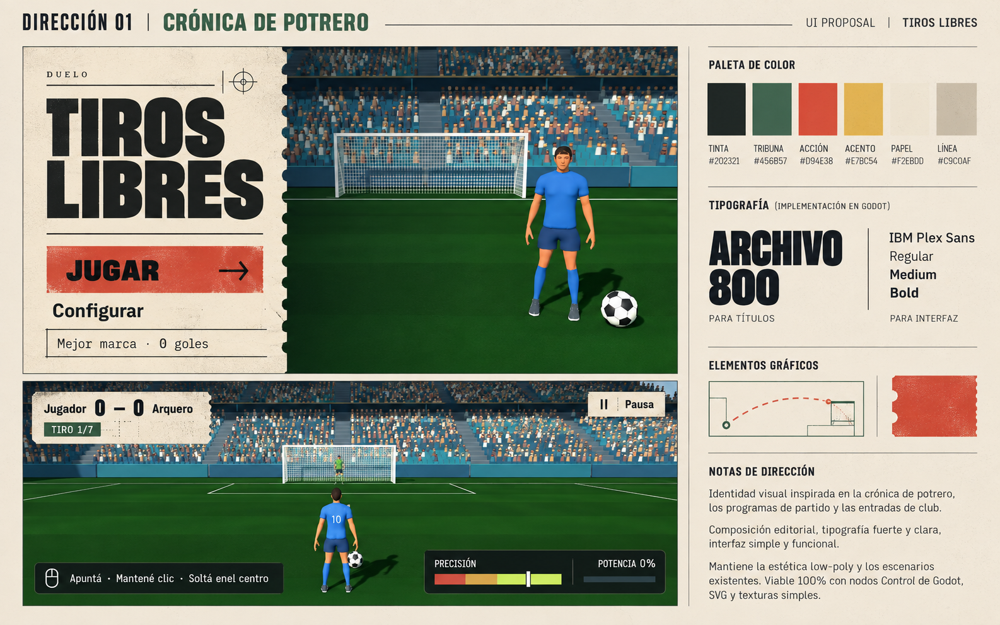
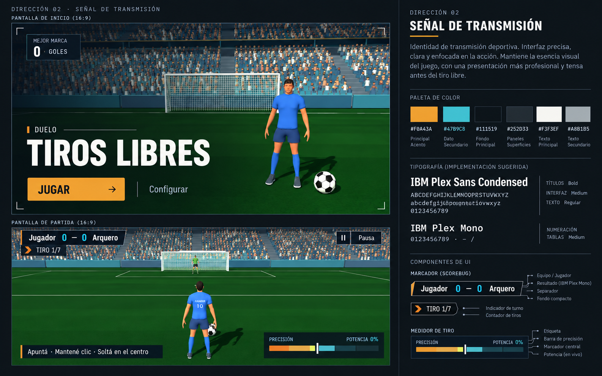
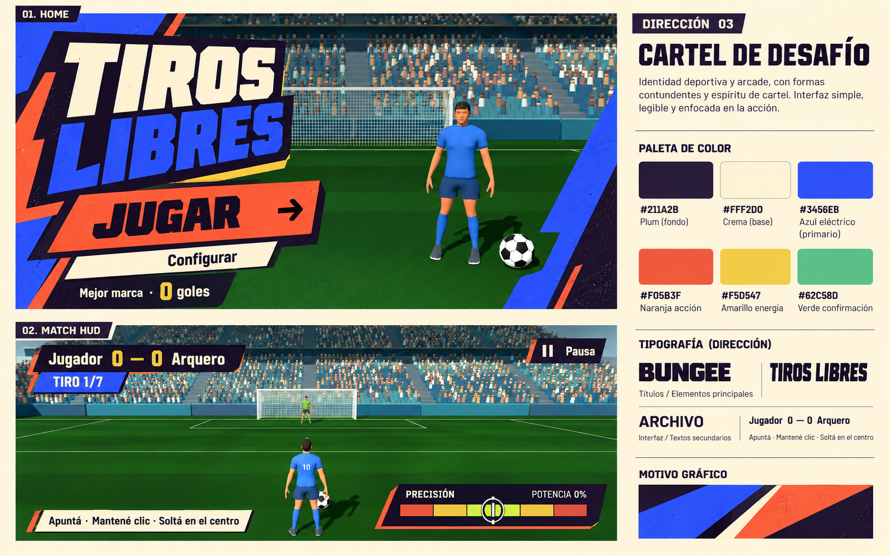

# Propuestas visuales de Tiros Libres

Tres direcciones comparables, cada una con inicio y HUD. Preparadas con Brandkit e image_gen integrado, a partir de las capturas del juego existente. Son conceptos visuales; todavía no están implementadas en Godot. Los prompts completos se conservan en [PROMPTS.md](PROMPTS.md).

## 01 — Crónica de potrero (recomendada)

Papel cálido, tinta, verde de tribuna y una acción roja. El inicio funciona como una entrada de cancha; el marcador continúa esa gramática. Tiene la mayor distancia respecto de la interfaz anterior y mantiene una voz local adulta.

Implementación propuesta: Archivo 800 para marca y títulos, IBM Plex Sans para controles; márgenes editoriales, botones rectos, una muesca vectorial moderada y textura de papel sutil. En la lámina la textura es más intensa de lo que conviene usar durante una partida: reducirla en el HUD. Mantener marcador compacto y foco visible mediante subrayado/barra.

Paleta canónica: tinta `#202321`, papel `#F2EBDD`, verde `#456B57`, rojo `#D94E38`, amarillo `#E7BC54`, separador `#C9C0AF`. Las leyendas HEX generadas en la imagen contienen pequeñas diferencias; usar estos valores y los del informe de investigación al implementar.

## 02 — Señal de transmisión

Estadio predominante, título en tercio inferior y marcador de transmisión compacto. La opción más sobria, de lectura rápida, aunque menos distintiva que potrero. IBM Plex Sans Condensed + Mono; carbón `#111519`, pizarra `#252D33`, blanco `#F3F3EF`, gris `#A8B1B5`, ámbar `#F0A43A`, cian `#47B9C8`.

## 03 — Cartel de desafío

Marca expresiva, cortes diagonales y colores de cartel deportivo. Es la opción de mayor energía. Bungee + Archivo; tinta `#211A2B`, crema `#FFF2D0`, azul `#3456E8`, naranja `#F05B3F`, amarillo `#F5D547`, verde `#62C58D`. Para producción: bajar el tamaño del título y mantener las instrucciones horizontales; reservar diagonales y sombra impresa para marca y acciones.

## Revisión de los conceptos

- Las tres láminas conservan el carácter sencillo del estadio y personajes, y muestran las mismas acciones principales. El render generado puede variar ligeramente sus proporciones; no implica cambios de modelado.
- Texto principal, marcador, pausa y medidor son legibles a escala de la lámina. Todavía falta validar la dirección elegida dentro de Godot a 1280×720 y 960×540, con teclado y selección activa.
- Las imágenes indican dirección tipográfica; los glifos generados no garantizan coincidencia exacta con los binarios reales de las fuentes.
- Los valores de marcador y turno son ilustrativos. La implementación debe mantener datos, controles y medidor conectados a la lógica existente.
- Evitar convertir el HUD en una textura rasterizada: construirlo con Control, Theme, SVG y texto real.

Siguiente etapa: implementar la dirección escogida en inicio y HUD, revisar capturas reales y después extenderla a ajustes, selección, pausa y resultados.
