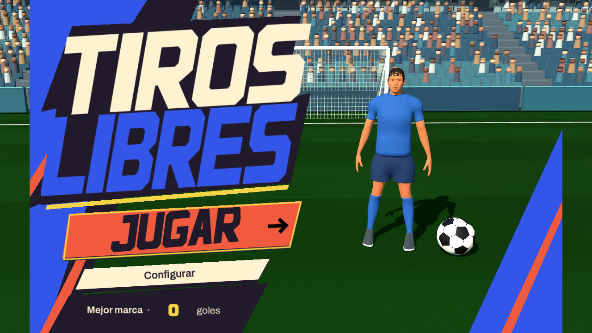
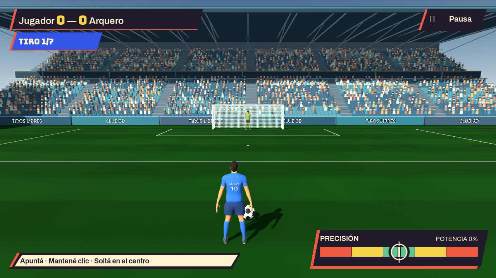

# Home y HUD: fidelidad a Cartel de desafío

Capturas reales de Godot del 4 de octubre de 2026. Se trabajaron primero la home y después el HUD contra la [propuesta original](../ui-concepts-2026-10-03/03-arcade.png).

## Home

Lettering angular y oblicuo, silueta escalonada, textura de impresión, JUGAR grande e inclinado, placa crema de Configurar, cifra del récord amarilla y encuadre del jugador más cercano a la referencia.

## Match HUD

Marcador compacto con cifras amarillas, turno azul, pausa recortada, ayuda breve a la izquierda y medidor a la derecha. El blanco circular acompaña al indicador durante la carga. La ayuda se amplía durante la defensa para mantener todos los controles disponibles.

## Comprobación

- Capturas de ambas pantallas a 1280×720 y 960×540.
- Medidor revisado durante carga y después de bloquear el tiro, además de su estado inicial.
- Revisados nombres largos, muerte súbita y cuatro jugadores.
- Pasaron las pruebas existentes menu_flow, round_flow y shot_and_keeper; se repitió menu_flow tras ajustar el encuadre de la home.
- Sin errores de scripts en las capturas con OpenGL. Los tests headless mantienen los avisos conocidos del renderer dummy y certificados del sandbox.

Las letras de la marca y el rótulo son vectores originales reconstruibles, y los demás textos y datos son controles reales. La escena 3D es la del juego; su aspecto depende del renderer y sus assets. Estas capturas documentan la implementación de home y HUD, no una coincidencia píxel a píxel con la imagen generada.
