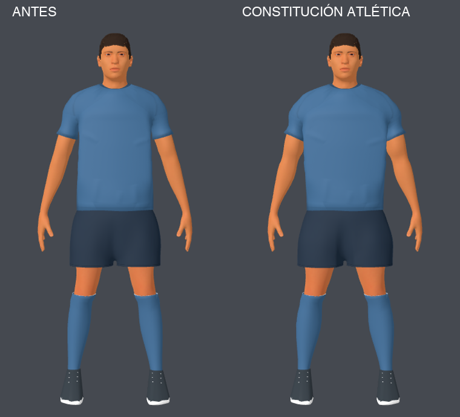

# Constitución atlética aplicada

Registro de la primera pasada. Fue revisada después del feedback sobre pecho y
piernas; el resultado actual está en [revisión de proporciones](revision-proporciones/resultado.md).

Se aplicó una postpasada al jugador actual después de las correcciones de short y mangas. Tres agentes investigaron referencias oficiales, compatibilidad de la pipeline y medidas de la malla. Se usaron las skills `research`, `create-game-assets`, `godot-animation` y `godot-3d-essentials`. Se conservan herramientas/assets gratuitos, sin importar modelos ni texturas comerciales.

## Cambios

- Torso superior/espalda: en la banda de vértices z1,38–1,43 seleccionada sobre la fuente, el ancho pasa de 0,4993 m a 0,5411 m (+8,37%). Puede incluir transición a brazo; es una medida comparable de la camiseta, no una medida anatómica exacta.
- Cintura: en la banda z1,07–1,11 pasa de 0,3925 m a 0,3990 m (+1,67%).
- Bíceps/tríceps: campo radial con pico +26% en t0,55 de UpperArm, visible bajo la manga. Se mezcla con los pesos existentes y desaparece hacia la articulación; el pico no es el aumento de todos los vértices.
- Antebrazo: pico +14% proximal, retorno gradual antes de muñeca; manos y dedos protegidos.
- Muslos: pico +13%, reduciendo el desplazamiento hacia el interior para conservar la abertura del short.
- Pantorrillas/medias: pico +12%, retorno a cero cerca de tobillo y rodilla.
- Ropa: acompaña el campo local. Se conservan el puente central y la cintura del short, el largo y la altura del ruedo. Paleta y texturas intactas.

Es una adaptación de la silueta observada en las [capturas oficiales de Football Strike](https://www.miniclip.com/games/football-strike). La foto posterior no determina una anatomía 3D única ni permite comprobar identidad exacta en zonas ocultas. Los porcentajes son decisiones de autoría, no dimensiones publicadas por Miniclip.

## Conservación y pruebas

Altura 1,90 m, cara, pelo, barba, cuello/collar, manos y botines protegidos. `auditoria-conservacion.json` verifica posiciones ajenas al cambio, topología, paleta, ambas UV, pesos, matrices de los 53 huesos y curvas de los ocho clips.

`auditoria-glb.json` compara el exportado con el anterior: inverseBindMatrices, JOINTS_0, WEIGHTS_0, UV0/UV1, índices y muestras de animación idénticos. Se mantiene el presupuesto de 89.843 triángulos; no se realizó un nuevo benchmark de FPS.

Se inspeccionaron `frente.png`, `espalda.png`, `perfil.png`, `patada.png` (0,6 s), `celebracion.png` (0,5 s), `estadio.png` y `gameplay.png`. No se observa piel atravesando la ropa en las zonas revisadas. Las capturas no certifican cualquier pose posible ni una simulación de tela.

Importación Godot completada. PASS: `athlete_v3_test.gd`, `custom_players_test.gd`, `kick_contact_and_dive_test.gd`. La última se ejecutó sin renders concurrentes. Sintaxis Python y `git diff --check` correctos.

## Entrega

Fuente: `source-assets/footballer/footballer_v3.blend`. Runtime: `apps/free-kick-3d/assets/footballer/footballer_v3.glb`. Ajuste reproducible: `apps/free-kick-3d/tools/athletic_footballer.py`, integrado al final de `build_footballer_v3.py`, con rechazo de aplicación acumulativa. Copia anterior de la sesión: `/tmp/footballer-before-athletic-pass.blend` y `.glb`.

Investigación: `referencia.md`, `pipeline.md` y `auditoria-base.md`. Cambios guardados localmente; esta pasada no se publicó ni se hizo commit de otros cambios presentes en el workspace.
