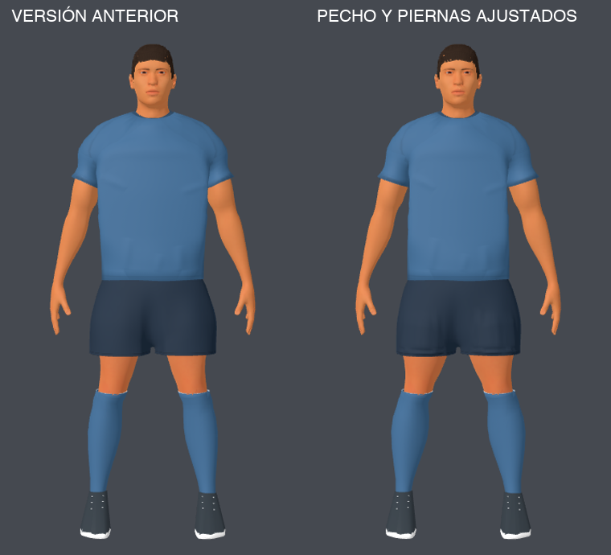

# Revisión: pecho contenido y piernas más fuertes

El usuario rechazó el tórax excesivo de la pasada anterior. Tres agentes revisaron capturas/trailer oficiales, compatibilidad de rig y radios de piernas usando las skills `research` y `create-game-assets`. Informes: [referencia y altura](referencia-altura.md), [torso y rig](torso-y-rig.md), [auditoría de piernas](auditoria-piernas.md).

## Cambios frente a la versión anterior

Medidos sobre el modelo y guardados en `medidas-comparadas.json`:

| Región / medida | Anterior | Actual | Cambio |
|---|---:|---:|---:|
| Ancho de la banda superior de camiseta | 54,11 cm | 49,76 cm | −8,05% |
| Profundidad de esa misma banda | 33,08 cm | 29,87 cm | −9,72% |
| Radio mediano de muslo, t≈0,65 | 8,85 cm | 10,04 cm | +13,53% |
| Radio mediano de pantorrilla, t≈0,35 | 6,48 cm | 7,23 cm | +11,62% |

Las medidas del torso usan el mismo conjunto de vértices elegido en la base preatlética (Jersey, z1,38–1,43 y abs(x)<0,25); son una comparación consistente de camiseta, no perímetros corporales. Radios medianos: vértices Skin/Thigh.R o Socks/Shin.R con peso>0,35 y ventana longitudinal ±0,075. Los parámetros nominales del campo son +30% muslo y +25% pantorrilla desde la base previa; no equivalen al aumento real frente al modelo rechazado.

Se redujo también la expansión del brazo superior de 26% a 22% para contener la transición lateral al pecho. Se preserva la cintura y la profundidad del pecho se contrae suavemente, evitando un bloque inflado bajo la camiseta.

El short recibe un campo nominal menor que el muslo (+8% desde la base previa). Se ajusta únicamente donde necesita cubrir piel: rayos horizontales desde el eje de cada pierna muestrean la piel visible y alturas vecinas, dejando 11 mm de holgura. Se conservan altura del ruedo, puente central, cintura continua y apertura entre piernas. Esto corrigió los cruces detectados en la primera revisión de los muslos nuevos, sin volver a reducirlos.

## Altura y referencia

En las [fuentes oficiales de Football Strike consultadas](https://www.miniclip.com/games/football-strike) no se encontró una estatura del personaje en metros. Sus capturas sirven para proporciones visuales; perspectiva, cámara y pose impiden obtener escala métrica exacta.

La fuente conserva 1,90 m, cadera al ~54% de altura y longitudes óseas existentes. En nuestro gameplay, la escala 1,15 lleva la altura efectiva a ~2,185 unidades. Esa escala es de nuestro proyecto y sigue igual; cambiarla requeriría revisar contacto de patada y cámara. No se inventó una estatura de Football Strike ni se retargetearon animaciones.

## Validación

`auditoria-conservacion.json`: posiciones de regiones ajenas al cambio, topología de fuente, pesos, huesos, curvas, paleta, UV y altura conservados. Cara, pelo, barba, cuello/collar, manos y botines protegidos. 53 huesos y ocho clips.

`auditoria-glb.json`: JOINTS_0, WEIGHTS_0, ambas UV, inverseBindMatrices, jerarquía y muestras de animación idénticos frente al GLB anterior. La lista de índices del short cambia al exportar la nueva forma; sólo afecta a esa superficie, con el mismo conteo de triángulos y topología de fuente intacta. El presupuesto total permanece en 89.843 triángulos.

Se inspeccionaron frente, espalda, perfil, detalle del short, Kick a 0,6 s, Celebrate a 0,5 s, estadio y cámara de gameplay. No se observa el cruce de muslos con short detectado en las versiones intermedias. La revisión corresponde a esas poses, no a cualquier pose arbitraria.

PASS: importación Godot, `athlete_v3_test.gd`, `custom_players_test.gd`, `kick_contact_and_dive_test.gd`. Esta última se ejecutó sin renders concurrentes. Sintaxis Python y `git diff --check` correctos. No se volvió a medir FPS.

## Archivos

Fuente actual: `source-assets/footballer/footballer_v3.blend`. Runtime actual: `apps/free-kick-3d/assets/footballer/footballer_v3.glb`. Ajuste reproducible en `apps/free-kick-3d/tools/athletic_footballer.py`, al final del generador. Se aplica desde la base anterior a la pasada atlética, evitando acumular escalados. Copia del estado rechazado de la sesión: `/tmp/footballer-before-balance-pass.blend` y `.glb`.

Assets/herramientas gratuitos; sin incorporar mallas ni texturas comerciales. Guardado localmente, sin publicación ni commit de cambios ajenos del workspace.
