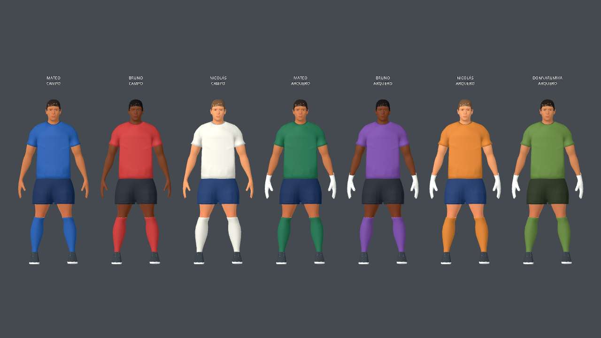

# Aplicado a todos los jugadores

Todos los jugadores de campo (Mateo, Bruno, Nicolás y personalizados) usan `footballer_v3.glb`; todos los arqueros (las tres variantes de color, Donnarumma y personalizados) usan `goalkeeper_v3.glb`. Las mejoras del primero ya se compartían entre sus variantes. Se actualizó el segundo con la misma secuencia: camiseta, short, transición de mangas y constitución equilibrada de pecho/piernas.

Los cuatro scripts aceptan un rol `footballer` o `goalkeeper`, guardan/exportan el archivo correspondiente y mantienen sus guardas contra aplicación acumulativa. El generador aplica ahora la secuencia a ambos modelos, para que las siguientes reconstrucciones conserven la mejora de toda la familia. Las auditorías del arquero se guardan con prefijo `goalkeeper` y no sobrescriben las del jugador de campo.

## Conservación

`auditoria.json` compara el arquero antes/después: cara/pelo/ojos, botines, guantes, barba, pesos, topología, huesos, curvas de animación, paleta y altura intactos. Además compara todos los vértices comunes de ambas fuentes actuales: diferencia máxima 0,0 m. Las proporciones y ropa del cuerpo común son exactamente iguales; el arquero conserva su geometría adicional de guantes.

Las variantes conservan colores, nombre, dorsal y selección de barba propios, además de la personalización. No se modificaron perfiles ni lógica de juego.

## Revisión y pruebas

Captura `familia.png`: siete presets con colores reales. `atajada.png`: SaveLeft a 0,3 s sobre el GLB del arquero actualizado.

PASS: `athlete_v3_test.gd`, `custom_players_test.gd`, `keeper_hands_test.gd`, `keeper_save_balance_test.gd`, `kick_contact_and_dive_test.gd`. La prueba de manos pasó también con el renderizador gráfico real; la ejecución dummy previa emitió avisos de materiales nulos al cierre. La prueba de balance pasó sus 13 casos y emitió avisos de recursos al cerrar. Sintaxis Python y `git diff --check` correctos.

Fuentes editables: `source-assets/footballer/footballer_v3.blend` y `goalkeeper_v3.blend`. Runtime: ambos GLBs en `apps/free-kick-3d/assets/footballer/`. Copia previa de la sesión: `/tmp/goalkeeper-before-family-pass.blend` y `.glb`.

Publicado el 4 de octubre de 2026 en [producción](https://futbol-tiros-libres-3d.netlify.app/), deploy `6ac2e9528e8115336c77b8e3`. Menú y personaje verificados en navegador; SHA-256 del PCK público igual al build local: `e507ad87a154e6c13916a7a1adf3724f2259fecced4d85b312e64625b8bbd019`.
