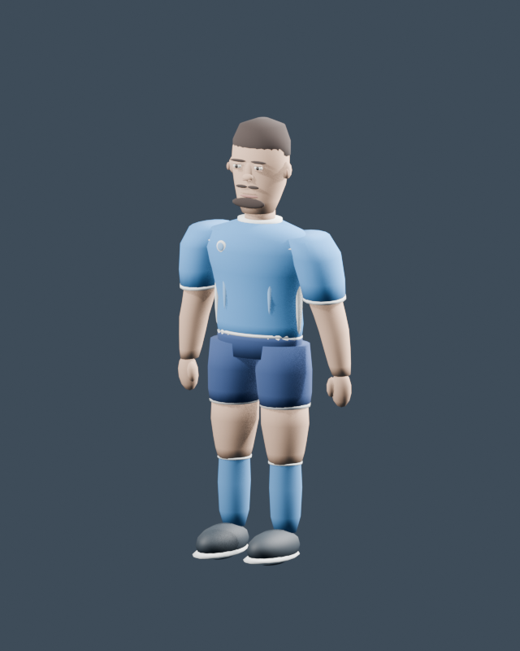
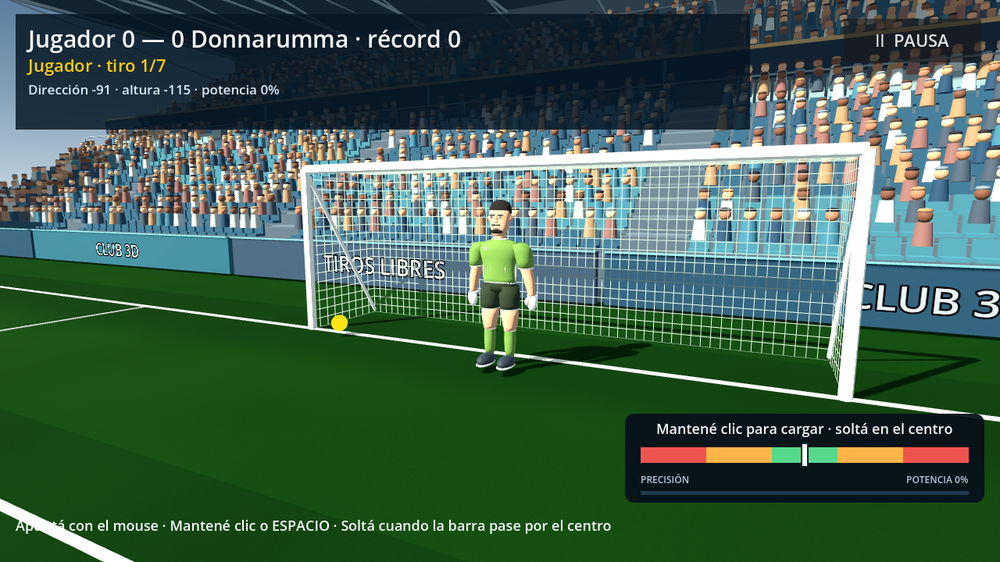

# Calidad del personaje: diagnóstico y ruta de reconstrucción

Fecha: 01/10/2026. Investigación con tres subagentes y revisión del coordinador. Restricción confirmada por el usuario: **solo herramientas y assets gratuitos**. Estado de referencia: commit `3081eeb`, Godot 4.7.1, Compatibility, PC primero y objetivo de 60 FPS.

## Decisión recomendada

**Reconstruir la base visual del personaje sobre una malla humana mejor resuelta, usando Blender y evaluando primero MPFB/MakeHuman.** Mantener el juego y sus reglas; incorporar la nueva malla mediante un adaptador visual. El personaje actual queda como respaldo y referencia funcional, no como estándar de calidad.

Esta es una recomendación de producción, no una integración ya probada. MPFB permite crear humanos en Blender, sus assets centrales son CC0 y no exige pagar por el uso de la herramienta ni sus salidas. Los assets comunitarios adicionales requieren revisar su licencia concreta. Fuentes: [licencia oficial](https://static.makehumancommunity.org/about/license.html), [FAQ de gratuidad](https://static.makehumancommunity.org/mpfb/faq/is_it_really_free.html).

La investigación anterior proponía mejorar una copia del modelo propio. Ya hicimos esa prueba con v2 y el resultado sigue por debajo de lo buscado. Por eso cambia la recomendación: una nueva pasada de rasgos y detalles sobre el mismo sistema de formas no resuelve el problema principal.

## Evidencia actual

Las imágenes se generaron durante esta revisión, sin modificar el modelo. La imagen anterior aportada al proyecto es una captura de nuestro juego; no debe confundirse con una referencia externa de Football Strike.

Observación visual del coordinador: cabeza con mandíbula muy estrecha y rasgos superpuestos; mangas y hombros voluminosos con transición abrupta; brazos y manos sin una estructura convincente; uniforme que se lee como piezas rígidas; botines inflados. El render neutro hace visibles esas carencias fuera de la iluminación del estadio.

La auditoría local encontró 73 componentes desconectados dentro de `FootballerBody` del delantero. Tener componentes separados no es, por sí mismo, un error: ojos, cabello o prendas pueden necesitarlo. Aquí el conteo, el código del generador y las imágenes muestran que unir objetos dejó gran parte de la construcción por piezas intacta. El conteo no sustituye el juicio visual.

Los GLB v2 tienen **10.876 triángulos en el delantero y 11.996 en el arquero, 18 huesos y cero imágenes de textura**. Más triángulos no han producido mejor anatomía. El código de personalización además reemplaza la ropa con materiales procedurales nuevos: importar un GLB texturizado sin actualizar ese código perdería parte del trabajo. Métodos, contratos y referencias: [auditoría anatómica](01-anatomia.md), [materiales e integración](03-materiales-integracion.md).

## Rutas gratuitas

| Ruta | Ventaja | Trabajo que sigue siendo necesario | Evaluación |
|---|---|---|---|
| MPFB/MakeHuman → Blender → GLB → Godot | Parte de una base humana con controles de forma y assets centrales CC0. | Estilizar atleta, crear/adaptar ropa, cabello, guantes y botines; preparar UV/materiales; adaptar rig y clips. | **Primera candidata para la prueba.** No es un futbolista terminado ni garantiza un acabado profesional. |
| Base gratuita Quaternius → Blender → Godot | Alternativa estilizada que puede acelerar rig y silueta. | Verificar contenido exacto del paquete gratis, adecuación de cara/cuerpo, uniforme y contacto de animaciones. | Candidata de respaldo; no asumir que todos los cuerpos o fuentes editables están en Standard. |
| Modelado manual nuevo en Blender | Máximo control sobre el diseño y los derechos del arte propio. | Anatomía, topología, UV, rig y texturas desde el comienzo. | Viable sin pago, pero exige más trabajo artístico y presenta mayor riesgo de repetir el problema actual. |

Comparación y fuentes oficiales: [rutas de producción](02-rutas-produccion.md). La ruta de MPFB también requiere preparar la exportación: su documentación recomienda materiales y rig GameEngine y limpiar geometría auxiliar; no garantiza que un personaje arbitrario se vea igual en Godot. [Exportación oficial](https://static.makehumancommunity.org/mpfb/docs/exporting/index.html).

## Orden de producción propuesto

1. **Definir el atleta:** vistas frontal, lateral y tres cuartos, con proporciones deportivas coherentes. Mantener una estilización moderada, sin agrandar cabeza, manos o calzado de forma accidental. Comparar con la dirección visual anterior, sin copiar modelos ajenos.
2. **Probar una nueva base humana sin texturas:** cuerpo y cabeza, primero con material gris. Evaluar hombros, cuello, pelvis, rodillas, rostro y manos. No pasar a variantes faciales hasta que la forma base se sostenga.
3. **Construir uniforme y accesorios:** camiseta y short con caída y espesor creíbles; botines con empeine, talón y suela; guantes con palma, pulgar y dedos legibles. Evitar pequeños relieves usados para ocultar formas mal resueltas.
4. **Preparar deformación:** probar patada, sentadilla y estirada alta/baja. Conservar clips si sirven; adaptar o rehacer los que no encajen con la nueva anatomía. Los 18 huesos actuales son un contrato existente, no un límite artístico obligatorio.
5. **Crear texturas UV:** albedo, normal y roughness cuando aporten, con máscaras para recolorear piel/ropa. Hornear detalle propio en Blender y comprobar el resultado en Compatibility. Actualizar la personalización para conservar mapas en vez de reemplazarlos.
6. **Integrar un candidato reversible:** nuevas fuentes y GLB en rutas separadas. Conservar dirección y sincronización del tiro, contacto de manos, pausa, reinicio y opciones de personalización mediante un adaptador.
7. **Evaluar en el juego:** menú cercano, vista de pateo y vista de atajada a 1280 × 720; capturas comparables y animaciones en movimiento. Medir tiempo de cuadro con estadio completo y las tres calidades.

## Criterios para aceptar el nuevo personaje

- Frente, perfil y espalda tienen una silueta atlética coherente; la calidad no depende de una sola cámara favorecedora.
- El rostro tiene volumen integrado y se lee sin ojos, nariz o boca como piezas pegadas; el cabello tiene un diseño intencional.
- Hombros, codos, cadera y rodillas no se separan ni colapsan en los clips usados por el juego. La ropa conserva volumen y no atraviesa el cuerpo de forma visible.
- Manos y guantes orientan palma y dedos hacia el contacto; los botines tienen proporción consistente con el pie y la pierna.
- Texturas sin costuras obvias, UV solapadas involuntariamente o sombras fuertes pintadas que contradigan la luz del estadio. Tela, piel y goma se distinguen.
- Nombre, dorsal y colores siguen editables por separado para delantero y arquero. Mantener `Label3D` puede servir como transición; no exigir su sustitución para probar la forma.
- Pasan las pruebas funcionales relevantes y el objetivo de 60 FPS se evalúa en hardware declarado, sin extrapolar la medición de este Mac a todas las PC.

La calidad visual se revisa con imágenes y movimiento: aprobar conteos de huesos, polígonos o tests no convierte el modelo en profesional. No se estima un plazo firme hasta exportar y evaluar la primera base candidata.

## Resultado de esta tarea y límites

- Snapshot previo guardado en `3081eeb`.
- Investigación por tres subagentes documentada en esta carpeta, con fuentes primarias y evidencia local.
- Captura actual en Godot y render Blender revisados; gameplay y assets no modificados por la investigación.
- Pruebas `custom_players_test.gd` y `kick_contact_and_dive_test.gd`: PASS. Godot emitió un error de certificados del entorno y la prueba de personalización un aviso de dos objetos al cerrar; no equivalen a fallos de sus aserciones.
- MPFB y los paquetes candidatos no están instalados ni descargados, ni se ha validado su importación aquí. El siguiente trabajo concreto es una prueba de base humana y silueta, antes de producir texturas o ampliar el conjunto de personajes.

## Notas por subagente

- [Anatomía, forma y deformación](01-anatomia.md).
- [Rutas de producción gratuitas y licencias](02-rutas-produccion.md).
- [UV, materiales, rig e integración](03-materiales-integracion.md).
