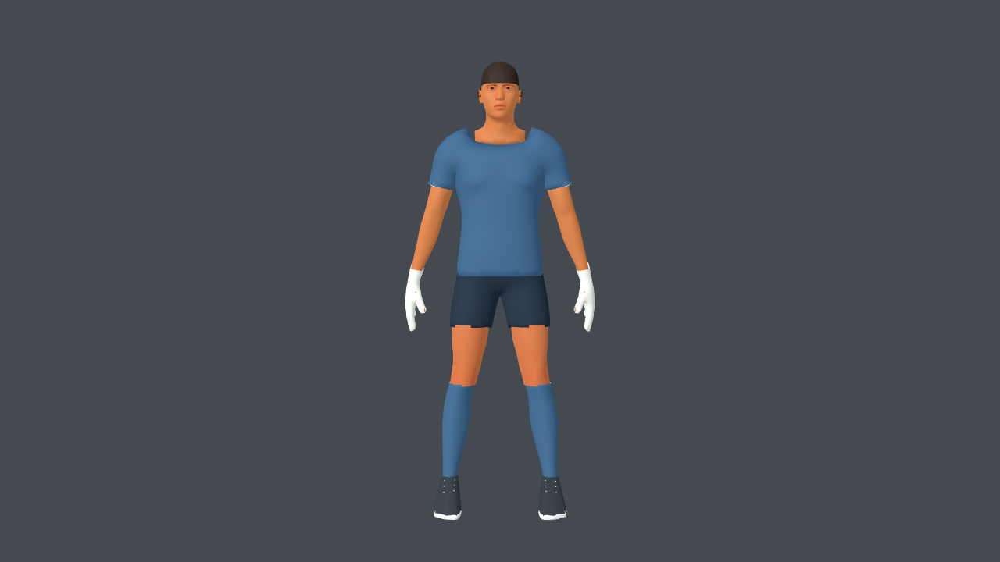
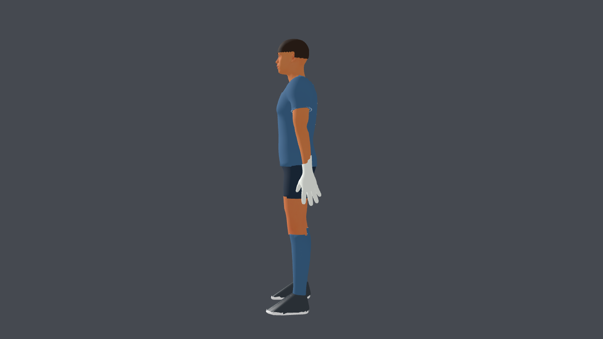
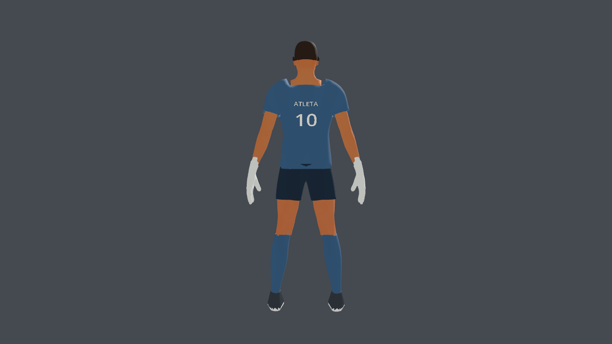
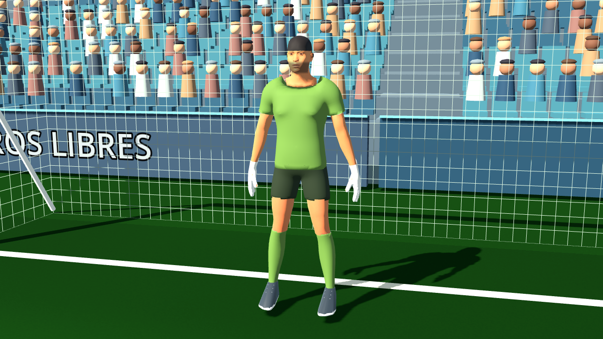
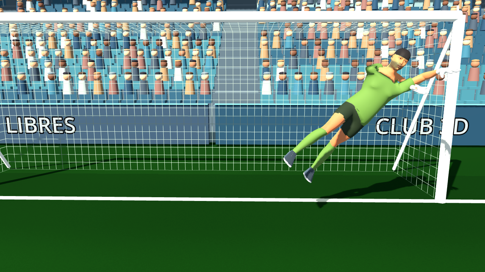

# Plan aplicado: atleta v3

Registro de la primera aplicación. La revisión visual y medición actuales están en
[v3-correcciones.md](v3-correcciones.md).

La ruta MPFB/MakeHuman → Blender → GLB → Godot ya está integrada en menú y partido.
Se sustituyó la base por primitivas por una anatomía humana CC0, con rig de 53 huesos,
uniforme propio y mapas de piel/tela. Los nombres y dorsales usan UV de la camiseta.
La personalización conserva mapas y recursos independientes por personaje.

## Revisión visual

Las capturas provienen de los GLB de esta primera aplicación importados en Godot. Se corrigieron
transparencia accidental de piel/ojos, dorsal espejado, intersecciones del uniforme
y discontinuidades visibles entre piel y prendas. La barba es opcional; la captura
neutra la oculta para revisar el rostro.

## Verificación

PASS: `athlete_v3_test`, `custom_players_test`, `kick_contact_and_dive_test`,
`keeper_hands_test`, `keeper_save_balance_test`, `round_flow_test`, `shot_and_keeper_test`.
El balance incluye 13 casos de sector/altura correctos e incorrectos.
Las pruebas headless emiten un aviso de certificados de macOS; algunas pruebas
antiguas de cierre emiten avisos de recursos/material del renderizador dummy.
Las aserciones y los procesos de las pruebas finalizan correctamente; la revisión
con el renderizador gráfico real no mostró esos avisos de material.

Medición en Apple M4, Godot 4.7.1 Compatibility, 1280×720, VSync desactivado,
90 cuadros de calentamiento y 300 cuadros medidos por perfil, con estirada:

| Calidad | Promedio | p95 | FPS medios |
| --- | ---: | ---: | ---: |
| Baja | 7,77 ms | 8,47 ms | 128,8 |
| Media | 10,48 ms | 11,39 ms | 95,4 |
| Alta | 10,77 ms | 11,68 ms | 92,9 |

El resultado supera el objetivo de 60 FPS en este equipo; no es una garantía para
otras PC. El delantero tiene 69.958 triángulos y el arquero 76.686; ambos contienen
7 imágenes de textura y conservan los 8 clips del proyecto.

## Fuentes y límites

Fuentes `.blend`, instrucciones de reconstrucción, licencias y manifiesto:
[footballer_v3.md](../../../source-assets/footballer/footballer_v3.md).
Todas las herramientas y assets externos utilizados son gratuitos; la base y los
assets de MakeHuman incluidos son CC0. Las versiones v2 se mantienen como respaldo.

La nueva base resuelve el problema principal de anatomía e integración de texturas,
pero no se declara un acabado profesional final. Cabello corto, botines, detalle
del uniforme y expresividad facial siguen simplificados. Las variantes comparten
anatomía y no reproducen el rostro de Donnarumma. El siguiente trabajo artístico
puede realizarse directamente sobre las fuentes editables, sin reconstruir el gameplay.
