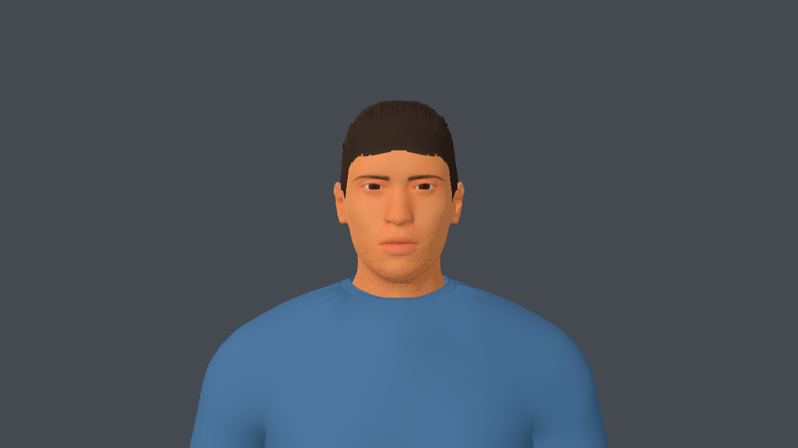
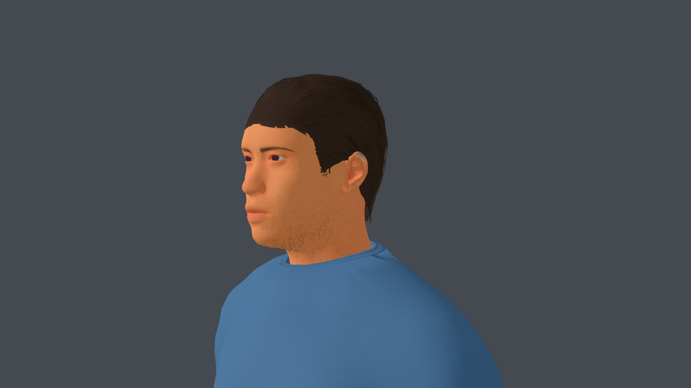
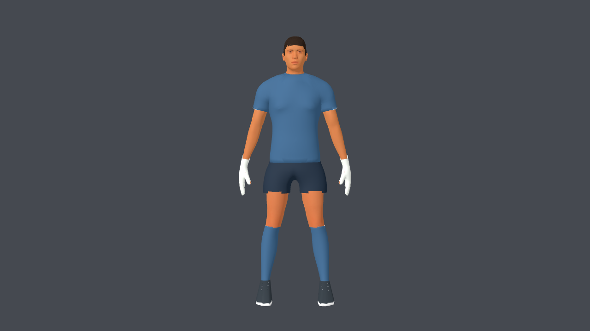
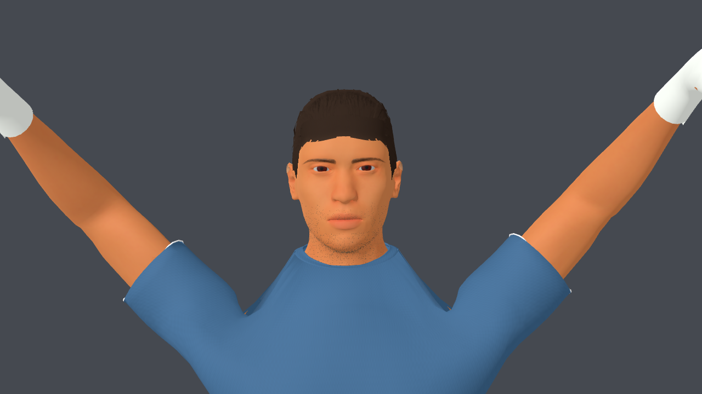
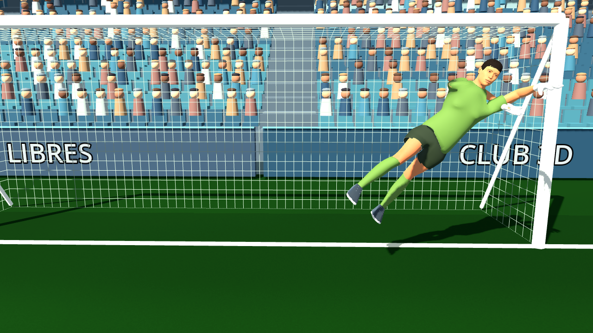

# Revisión del personaje — 3 de octubre de 2026

Registro previo. La revisión posterior del uniforme está en
[v3-pantalones-y-mangas.md](v3-pantalones-y-mangas.md).

## Cambios integrados

La unión cuello/remera vuelve a conservar la anatomía original. Se eliminó el
recorte radial que borraba piel de la garganta, se ajustó la abertura a un cuello
redondo deportivo y se conectó el ribete al borde real de la camiseta. Comparten
posiciones y pesos en la unión; el interior del ribete sigue el relieve anatómico.
Se relajó la topología contigua del hombro y se corrigieron normales y el borde
blanco accidental. Las fuentes Blender y ambos GLB están regenerados.

Esta revisión también conserva las mejoras realizadas antes de la pausa:
mechones CC0 `short04` con atlas recoloreable, barba de briznas opacas en lugar de
una mancha sobre la cara y short con cintura, entrepierna y dos piernas propias.
Solo se usaron herramientas gratuitas y assets externos CC0.

## Evidencia en Godot

Capturas del GLB actualizado, Godot 4.7.1 Compatibility a 1280×720.

Las capturas neutras usan el arquero; por eso incluyen guantes. La barba se
muestra en primeros planos y se oculta en la vista completa para revisar silueta.
La revisión visual confirma continuidad del cuello en estas poses; las pruebas
funcionales por sí solas no verifican calidad artística.

## Verificación actual

PASS: `athlete_v3_test.gd`, `custom_players_test.gd`,
`kick_contact_and_dive_test.gd`. Conservan personalización independiente,
texturas, dorsal UV, sincronización de patada y estirada. El modo headless
emite el aviso de certificados conocido de macOS; las aserciones pasan.

Apple M4, estadio completo, VSync desactivado, 90 cuadros de calentamiento y
300 cuadros medidos por perfil:

| Calidad | Promedio | p95 | FPS medios |
| --- | ---: | ---: | ---: |
| Baja | 8,29 ms | 10,00 ms | 120,7 |
| Media | 10,96 ms | 12,44 ms | 91,2 |
| Alta | 11,57 ms | 12,76 ms | 86,4 |

La escena incluye los cambios actuales del workspace en audio e interfaz. Esta
medición describe el conjunto; no permite atribuir la diferencia respecto de la
v3 inicial solamente al modelo. El resultado se limita a este equipo.

Geometría exportada: delantero 80,235 triángulos, arquero 86,963;
53 huesos, 8 clips y 7 imágenes embebidas por GLB. Hashes y métricas en
[athlete_v3_manifest.json](../../../source-assets/footballer/athlete_v3_manifest.json).

## Pendientes artísticos

La base sigue necesitando trabajo para un acabado profesional. En poses extremas
la unión de mangas y axilas aún muestra recortes y una caída de tela poco natural;
conviene reconstruir esa topología con flujo de aristas de una prenda. El pelo
requiere afinar la línea frontal y la nuca; la barba corta necesita una distribución
más orgánica. Piel, costuras y botines todavía tienen un acabado simplificado.
Las variantes actuales comparten anatomía y no reproducen rostros específicos.

Los cambios permanecen en el workspace sin nuevo commit.
