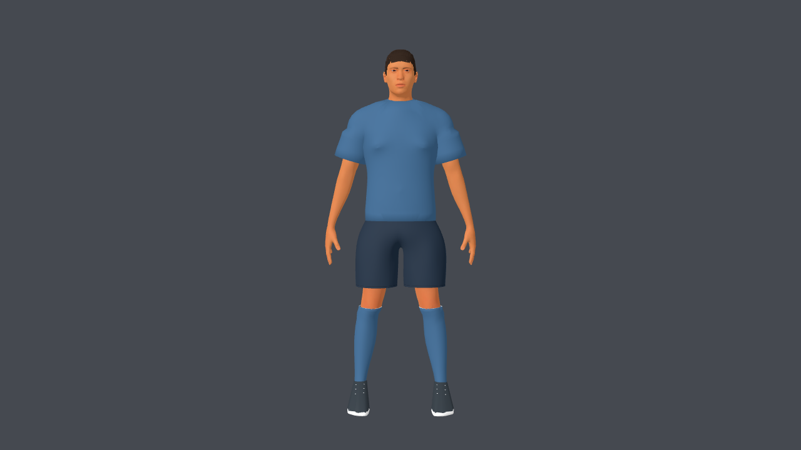
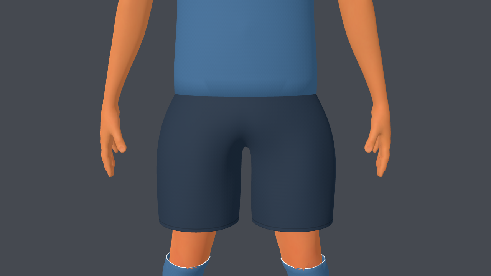
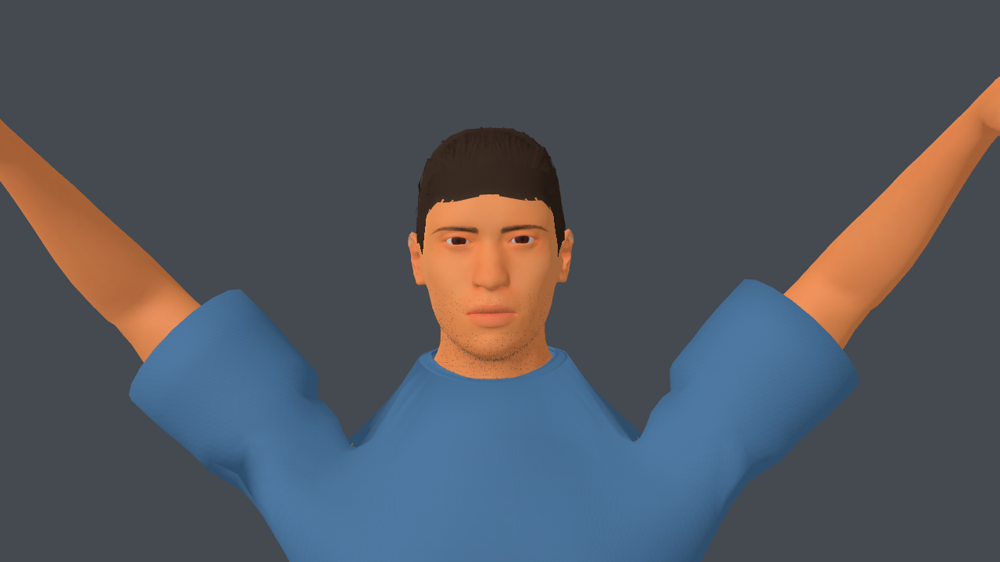
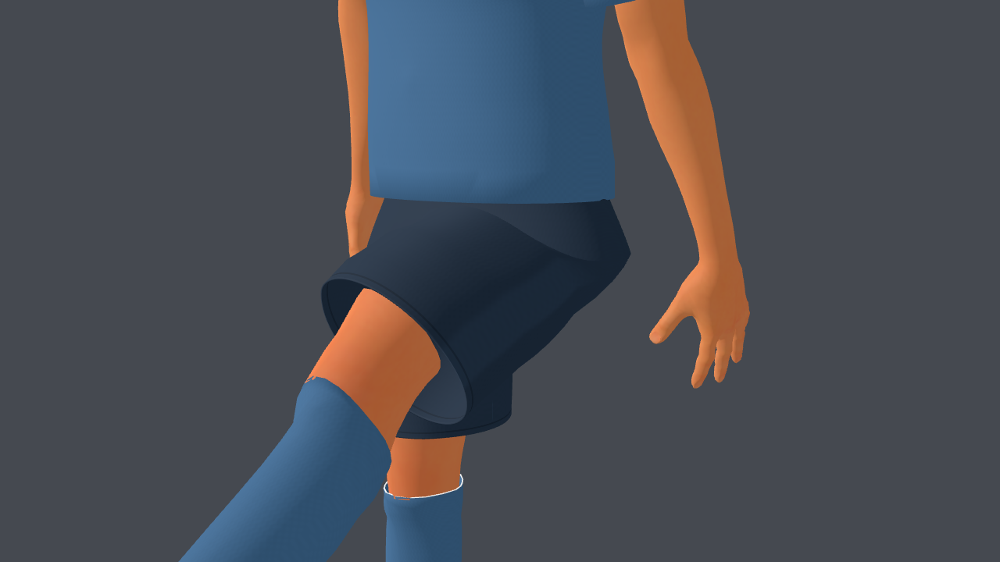

# Corte de fútbol según referencia del usuario

Registro anterior. El pedido posterior corrige el corto a medio muslo y cambia
mangas/pecho: [v3-secuencia-short-mangas-pecho.md](v3-secuencia-short-mangas-pecho.md).

Se ajustaron las fuentes Blender y los GLB del delantero y arquero a la captura
recibida: short próximo a la rodilla y camiseta con mangas más sueltas.

## Ajustes

- El borde del short baja de 0,760 a 0,655 m en la base de 1,90 m: 10,5 cm
  adicionales de largo. Los anillos de cada pierna mantienen una caída ligeramente
  suelta y dobladillo recto. UV y costura se ajustan al nuevo borde.
- La manga pasa de 16 a 20,5 cm desde el inicio del brazo del rig. La sección
  final tiene 8,8 cm de radio y una caída recta. La camiseta tiene mayor holgura
  lateral y más suavizado de tela. El borde es una lámina de 1 mm hacia afuera;
  no se agrega una banda ni una vuelta hacia adentro.
- La piel oculta bajo el short se recorta hasta el nuevo dobladillo con solape
  y pesos de muslo, para evitar la intersección que apareció en la patada alta.
- Se conservan el cuello corregido, color personalizable, mapas, nombre/dorsal,
  rig y los ocho clips existentes. El generador valida las mallas antes de exportar.

La captura del usuario se guarda únicamente como referencia de diseño en
[source-assets/footballer/references](../../../source-assets/footballer/references/football-kit-user-reference.png).
No forma parte de los assets ni las texturas del juego.

## Capturas de Godot

La captura de mangas corresponde a la misma geometría/materiales de camiseta
antes del último recorte de piel de muslo; ese recorte solo afecta las piernas.

## Verificación

PASS: `athlete_v3_test.gd`, `custom_players_test.gd`,
`kick_contact_and_dive_test.gd`; revisión visual de Idle, Celebrate y Kick,
y comprobación del arquero en el estadio. `git diff --check` sin problemas.
El aviso de certificados de macOS continúa en las pruebas headless.
El rendimiento del manifiesto corresponde al uniforme anterior; no se volvió
a medir este ajuste de corte. Los hashes y geometría sí corresponden a los GLB
actuales. La caída de tela en poses extremas sigue simplificada.

Cambios guardados sin nuevo commit.
