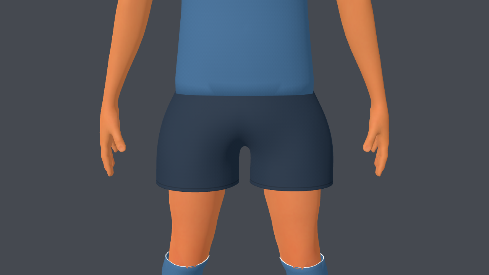
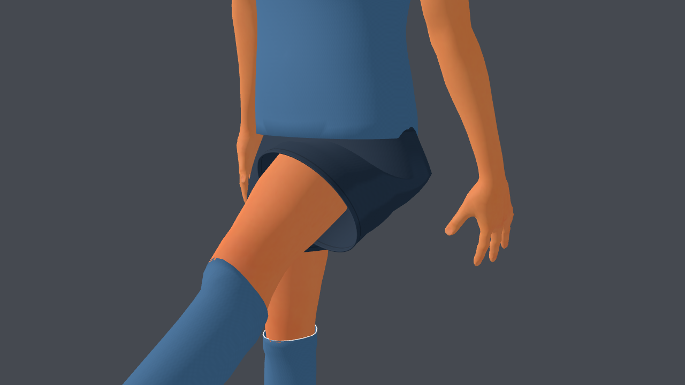
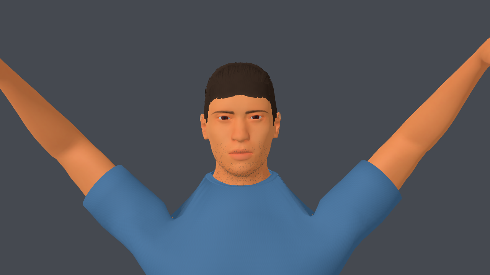
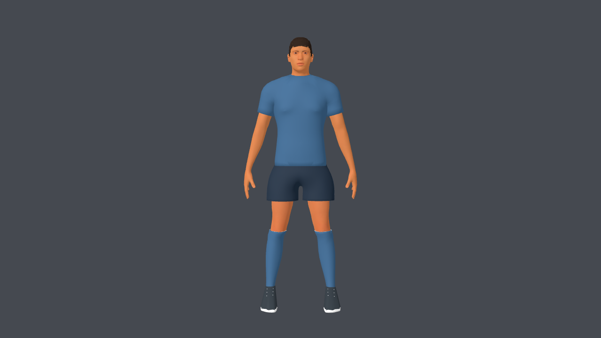
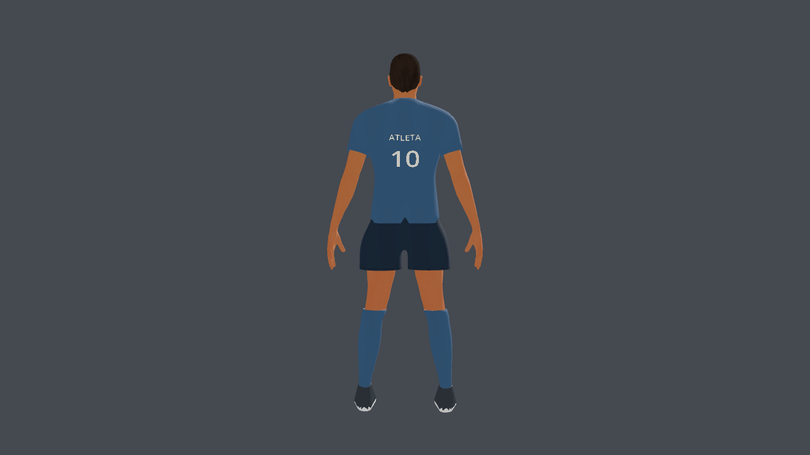
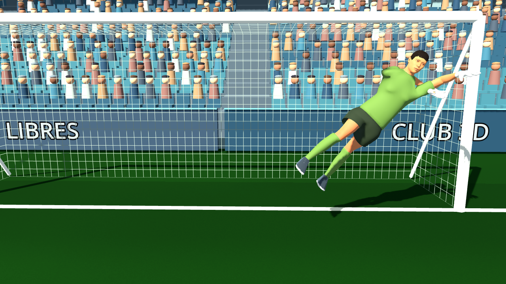

# Pantalones, mangas y deformación del uniforme — 3 de octubre de 2026

Registro anterior al ajuste de corte solicitado con la captura del usuario.
Revisión actual: [v3-corte-referencia.md](v3-corte-referencia.md).

## Resultado

El short tiene mayor holgura en cadera y piernas, algo más de largo y una
entrepierna con tres puntos de soporte en lugar de un único vértice central.
La cintura lleva anillos de soporte y solapa bajo la remera. Los dobladillos
son nivelados y comparten el material de la prenda; se agregaron pliegues
geométricos suaves y costuras/paneles tonales mediante UV secundarias.
El shader corrige la inversión de V que se comprobó en el GLB exportado.
El color del short sigue siendo personalizable.

Las mangas se seleccionan y cortan en un plano perpendicular al brazo,
reemplazando el recorte por altura. Piel y manga comparten el plano de unión,
con un pequeño solape y pesos estables de brazo. Se conserva más piel bajo
la axila y se aumentó el margen de tela en los hombros para evitar pequeñas
intersecciones. La remera mantiene el cuello redondo de la revisión anterior.
El bajo se ancla gradualmente a la pelvis para que no se abra la cintura en
patadas altas. También se ajustó el borde de las medias a la piel.

Se eliminaron grupos auxiliares de MPFB en la malla corporal, se normalizaron
sus pesos a cuatro influencias y se corrigió la mutación de pesos tomando
una copia de índices antes de eliminar asignaciones. Las fuentes Blender
quedan libres del aviso de pesos negativos y se regeneraron ambos GLB.

## Revisión visual en Godot

Capturas a 1280×720. Vistas neutras del delantero sin guantes; la estirada
usa el arquero con su uniforme del partido.

Las poses revisadas son Idle, Celebrate a 0,4 s, Kick a 0,6 s y estirada
en el estadio. Confirman continuidad de mangas y cintura y dobladillos
regulares en estas vistas; no certifican cualquier pose futura.

## Validación

PASS: `athlete_v3_test.gd`, `custom_players_test.gd`,
`kick_contact_and_dive_test.gd`; `git diff --check` sin problemas.
Blender `Mesh.validate` devuelve `False` para cuerpo y barba (sin reparaciones
necesarias). El generador valida también cada rol antes de guardar/exportar.
El exportador conserva un aviso de más de cuatro influencias en la barba,
que reduce al contrato GLB, y avisos sobre nodos de texturas compartidas.
La prueba headless sigue emitiendo el aviso conocido de certificados de macOS.

Exportaciones actuales: delantero 87,539 triángulos, arquero 94,267;
53 huesos, 8 clips y 7 imágenes embebidas por rol. Fuentes, procedencia y hashes:
[footballer_v3.md](../../../source-assets/footballer/footballer_v3.md),
[athlete_v3_manifest.json](../../../source-assets/footballer/athlete_v3_manifest.json).
No se agregaron assets pagos ni nuevas dependencias.

## Rendimiento

Apple M4, Godot 4.7.1 Compatibility, estadio a 1280×720, VSync desactivado,
90 cuadros de calentamiento y 300 medidos por perfil. Medición final:

| Calidad | Promedio | p95 | FPS medios |
| --- | ---: | ---: | ---: |
| Baja | 8.13 ms | 8.75 ms | 123.1 |
| Media | 10.88 ms | 11.78 ms | 91.9 |
| Alta | 11.21 ms | 12.10 ms | 89.2 |

Una medición previa, antes de la limpieza final de pesos, dio 70,8/51,4/52,5 FPS.
Se observó actividad concurrente de otras aplicaciones en el escritorio. La
repetición final dio los valores de la tabla; no se aisló la causa de la variación
ni se cerraron aplicaciones del usuario. Ambas mediciones están registradas en
el manifiesto. Estos resultados no garantizan rendimiento en otras máquinas.

## Alcance artístico restante

La forma y continuidad del uniforme mejoraron. La caída en poses extremas sigue
simplificada y aún puede afinarse con topología de ropa dedicada. Pelo, barba,
piel, botines y expresión facial conservan los límites anotados en la revisión
anterior. Esta entrega no representa el acabado artístico final del personaje.
Cambios guardados en el workspace, sin nuevo commit.
