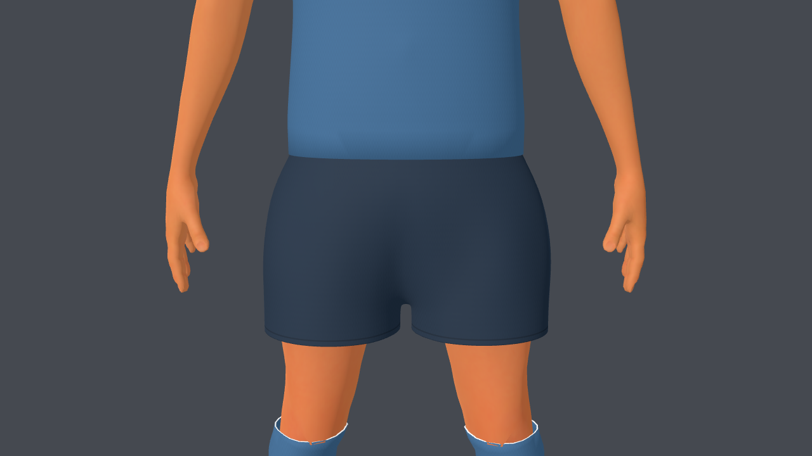
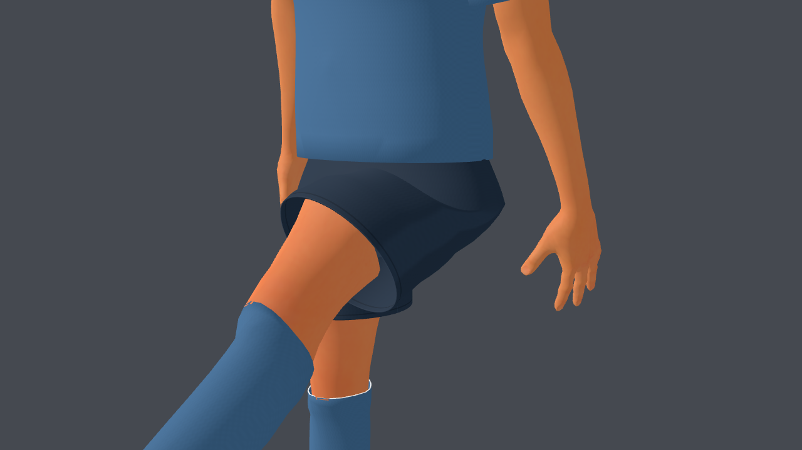
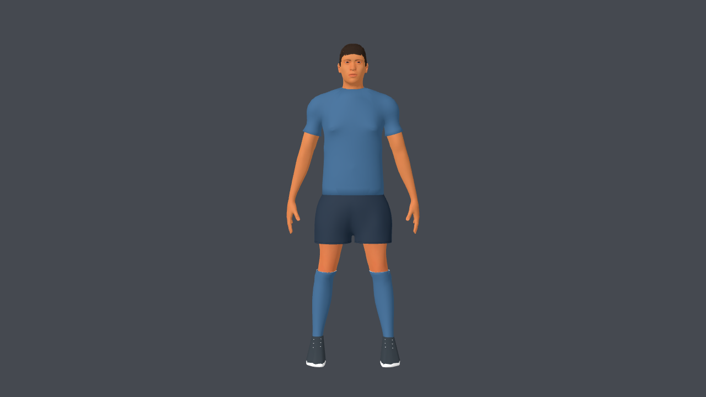
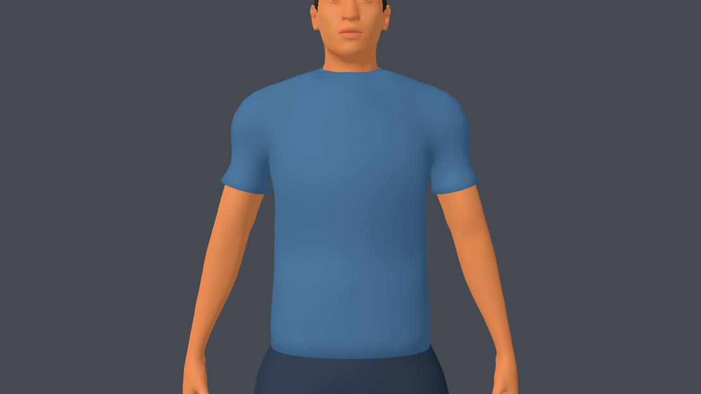
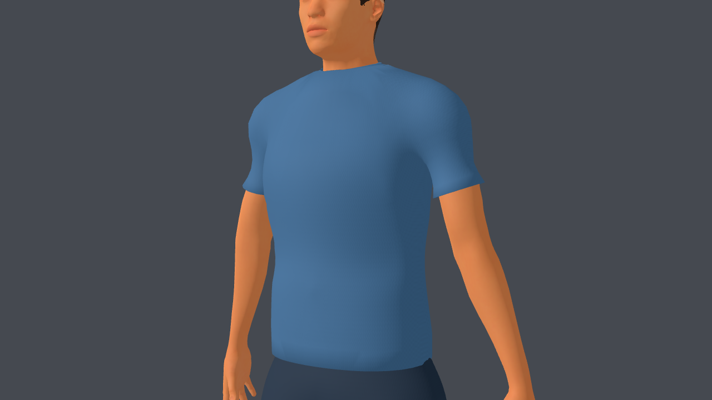
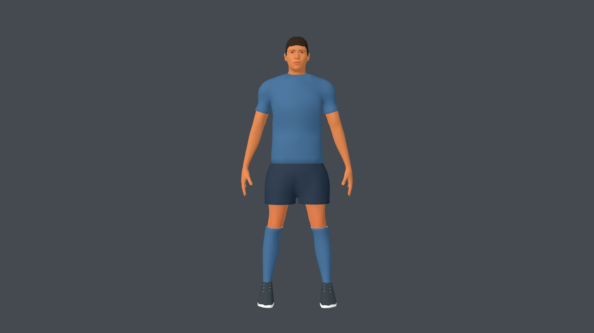
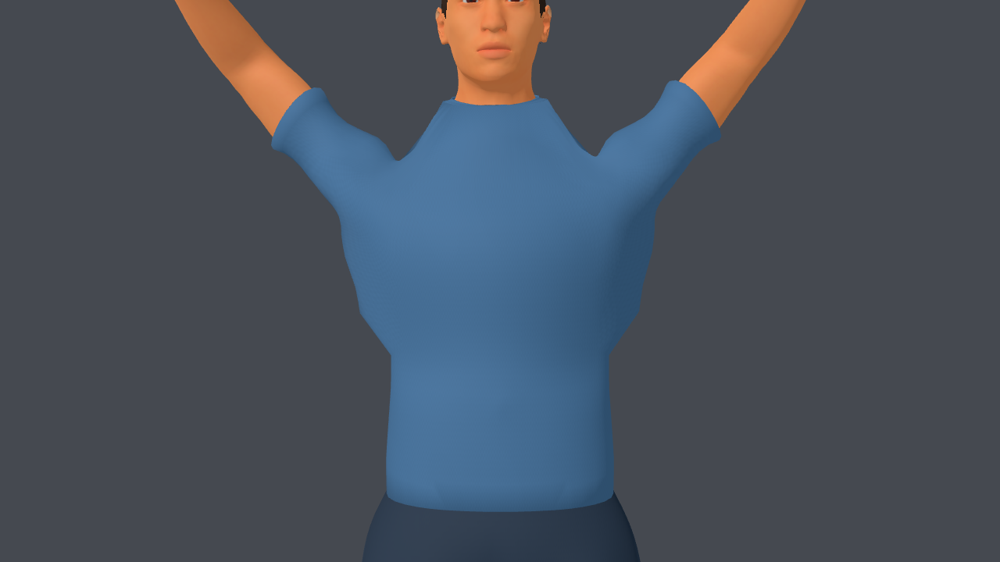
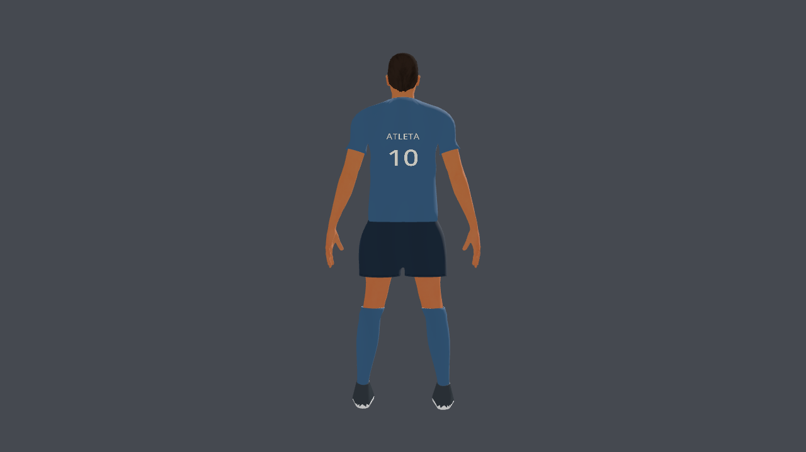

# Corrección secuencial: short, mangas y pecho

## Dirección

Se siguió el pedido específico posterior a las referencias de Football Strike:
medio muslo, abertura pequeña en entrepierna, mangas moderadas a mitad de bíceps,
transición sin pieza separada y torso liso. Las tres capturas del usuario quedan
como referencia en `source-assets/footballer/references/`; no se usan como texturas
ni se incorporan al runtime. Un agente Luna hizo una auditoría de solo lectura del
generador y detectó el cambio brusco de radio/X en mangas y la forma anatómica
heredada en el pecho. No modificó archivos.

## 1. Short

Se bajó la entrepierna compartida de 0,865 a 0,758 m; el dobladillo quedó a
0,715 m en la base de 1,90 m. La abertura vertical se reduce a unos 4 cm.
Los centros de pierna quedan a ±0,121 m con radio lateral de 0,115 m: separación
pequeña y caída casi recta, ligeramente holgada. La cintura y la unión central
siguen siendo una sola malla conectada. Los anillos interiores descienden desde
la entrepierna; no se genera una vuelta hacia arriba que deforme esa unión.
Se mantienen pesos de pelvis/muslos y el solape de piel oculto bajo el borde.

## 2. Mangas

Se acortó la manga a 15,8 cm desde el inicio del brazo del rig. Se eliminó el
radio constante de 8,8 cm aplicado tras un umbral X: la superficie ahora sigue
el brazo anatómico con 12 mm adicionales, mediante una transición gradual.
La unión se suaviza a través del hombro y la manga sobre la misma topología,
con límites de relajación graduales. Los pesos pasan hacia el brazo de manera
progresiva; el borde mantiene el peso del brazo que también usa la piel en la
unión. No se agrega una pieza de manga ni una banda doblada hacia dentro.

## 3. Pecho

La camiseta era una copia de la anatomía desplazada; conservaba bultos locales.
Se ajustó una superficie amplia y suave al frente del torso, con transición en
los bordes. Cambia solo la coordenada frontal Y; se conservan X/Z y los pesos
existentes. Se retiró la piel cubierta hasta debajo del cuello para evitar
superposición en la parte alta del pecho. El cuello visible permanece intacto.

## Resultado final y validación

PASS: `athlete_v3_test.gd`, `custom_players_test.gd`,
`kick_contact_and_dive_test.gd`; `git diff --check` sin problemas. Los procesos
headless mantienen el aviso conocido de certificados de macOS.

La comparación de fuentes antes/después de los pasos 2 y 3 verifica:
geometría de cara/pelo/barba/botines igual, colores iguales, altura igual,
matrices y nombres de los 53 huesos iguales y curvas de los ocho clips iguales.
Cuerpo y barba pasan la validación de malla Blender sin reparaciones.
Resultado: [v3-secuencia-auditoria.json](v3-secuencia-auditoria.json).
El paso 1 modificó solo el short, su piel oculta y la altura de la costura.

Hashes y conteos actualizados en
[athlete_v3_manifest.json](../../../source-assets/footballer/athlete_v3_manifest.json).
La medición de FPS del manifiesto es histórica, no corresponde a este corte.
Esta revisión resuelve la silueta solicitada en las poses inspeccionadas; no
simula tela física ni verifica poses futuras fuera de los clips existentes.
Cambios guardados sin nuevo commit.
