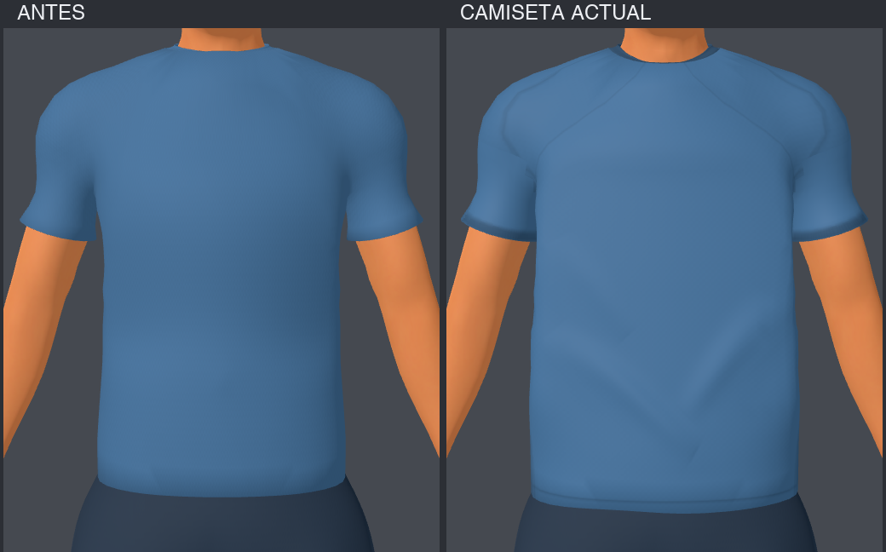

# Camiseta del jugador: investigación y mejora aplicada

4 de octubre de 2026. Tres agentes investigaron fotos oficiales, modelos gratuitos
y la construcción técnica del personaje. Presupuesto: herramientas y assets
gratuitos. Objetivo: una camiseta deportiva ligera, algo suelta, con cuello,
 caída y detalles que se lean en un personaje del estilo Football Strike.

## Qué enseñan las referencias

Las fotos oficiales de [Nike](https://about.nike.com/en-GB/newsroom/collections/nikes-national-federation-kits-bring-dri-fit-adv-to-the-pitch),
[adidas](https://news.adidas.com/sports/adidas-and-real-madrid-reveal-white-home-kit-rooted-in-tradition-for-2024-25-season/S/6c62faf7-a3a5-4b7b-a66f-bb7858d5d548)
y la [captura oficial de Football Strike](https://static-prod-web.miniclip.com/assets/games/FootballStrike/05_StoreScreenshots/FBS_SCR_IPhone_05_EN.jpg)
permiten comparar cuello, mangas y tela en jugadores vestidos. Nuestra inferencia
visual: el modelo anterior seguía demasiado el volumen muscular, tenía cuello casi
invisible y un bajo rígido. Hace falta controlar la envolvente de tela y localizar
pliegues en axilas/flancos/bajo, manteniendo el centro del pecho limpio.

El [escaneo Soccer jersey de Guitomic](https://sketchfab.com/3d-models/soccer-jersey-505135b60524470493ebe08f7a8718b7)
(gratuito, CC Attribution según la ficha original indexada) sirve de referencia de
prenda; no se verificaron archivos ni rig. La alternativa CC0 de
[MakeHuman Shirts01](https://static.makehumancommunity.org/assets/assetpacks/shirts01.html)
es adaptable, pero necesita trabajo de corte y pesos. Se eligió ajustar nuestra
malla para conservar el rig existente. No se descargaron ni incorporaron modelos,
logos o texturas externas.

Informes de los agentes:
- [Fotos y diagnóstico visual](referencias-fotograficas.md).
- [Modelos gratuitos y límites verificados](modelos-gratuitos.md).
- [Auditoría técnica de la versión anterior](auditoria-tecnica.md).

## Cambios, en orden

1. **Caída y torso:** holgura diferenciada en abdomen y costados, panel frontal
   amplio que puentea pectorales, bajo 17–19 mm más bajo con variación suave y
   solape sobre la cintura. Mantiene los pesos originales y el anclaje a pelvis.
2. **Mangas y cuello:** sección de manga oval más uniforme hacia el borde,
   conservando largo de 15,8 cm; transición continua sobre la malla existente.
   El frente del cuello desciende 17 mm y recibe un ribete tonal fino. Se conserva
   la piel del cuello, sin modificar cabeza, cara o pelo.
3. **Tela y confección:** tres pliegues asimétricos dirigidos desde los flancos
   hacia el bajo; atlas UV0 cilíndrico para torso y local para mangas/cuello.
   Mapas originales 512² de albedo, normales y roughness, con paneles laterales,
   líneas suaves de confección, borde de manga y canalé del cuello.
   UV2 del nombre/dorsal permanece idéntica. Godot usa la intensidad de normales
   exportada por Blender; short/medias/arquero conservan sus mapas e intensidad.

La nueva etapa `apps/free-kick-3d/tools/tailor_footballer_jersey.py` se integra al
final del generador base. También permite iterar sobre una fuente v3 sin refinar;
rechaza aplicar de nuevo el cambio a una camiseta ya refinada. Conserva una huella
de posiciones protegidas, pesos, paleta y UV del dorsal antes/después.

## Comparación y capturas

Misma cámara e iluminación de estudio; el antes corresponde a la camiseta previa,
compartida por ambas bases. La composición recorta sólo la zona de prenda.

- [Frente completo](camiseta-front.png), [perfil](camiseta-torso_profile.png).
- [Espalda/dorsal](camiseta-back.png), [patada](camiseta-patada.png).
- [Celebración con brazos alzados](camiseta-celebracion.png).
- [Jugador en el estadio](camiseta-estadio-jugador.png).
- [Arquero anterior, referencia de contexto](camiseta-estadio.png).

## Validación

PASS: `athlete_v3_test.gd`, `custom_players_test.gd`,
`kick_contact_and_dive_test.gd`; importación Godot y renders Compatibility sin
nuevos errores; `git diff --check`; sintaxis Python. Exportación web release
completada sin errores. No se hizo una nueva publicación ni una nueva prueba de
carga en navegador para esta revisión.

La prueba de contacto tuvo un primer fallo de 0,44 m frente al umbral 0,42 m
mientras se capturaban imágenes simultáneamente. Pasó aislada y volvió a pasar
con el material final. Las curvas y huesos son idénticos; no se modificó gameplay
ni se amplió el umbral. La concurrencia es una posible explicación, no una causa
probada.

[Auditoría comparativa](auditoria-conservacion.json): pesos y UV del dorsal
idénticos, short/medias/cara/pelo/botines protegidos, paleta y altura iguales,
53 huesos y ocho clips con curvas idénticas, meshes válidas sin reparaciones.
El hash del GLB del arquero permanece igual.

GLB jugador: **89.843 triángulos**, igual que antes; **7.376.420 bytes**, aumento
104.012 bytes (aprox. 102 KiB); imágenes embebidas de 7 a 10 por los tres mapas
exclusivos de camiseta. La exportación web actual ocupa unos 59 MiB e incluye
otros cambios del workspace; ese aumento global no se atribuye a la camiseta.
El benchmark de FPS del manifiesto sigue siendo histórico, no una medición nueva.

## Límites y estado

La caída es modelada y acompaña el skinning existente; no hay simulación de tela
ni pliegues que se recalculen según cada movimiento. Se revisaron las poses
capturadas y la personalización, pero el acabado aún admite trabajo artístico de
axila/hombro y pliegues específicos por animación. Guardado en las fuentes,
GLB y material runtime; sin commit nuevo ni publicación de esta revisión.

## Revisión posterior

La [segunda pasada](segunda-pasada/resultado.md) sustituye los pliegues en V y
refina hombros, axilas y mangas. Las capturas anteriores documentan la primera
pasada; las fuentes y GLB actuales corresponden a la segunda.
