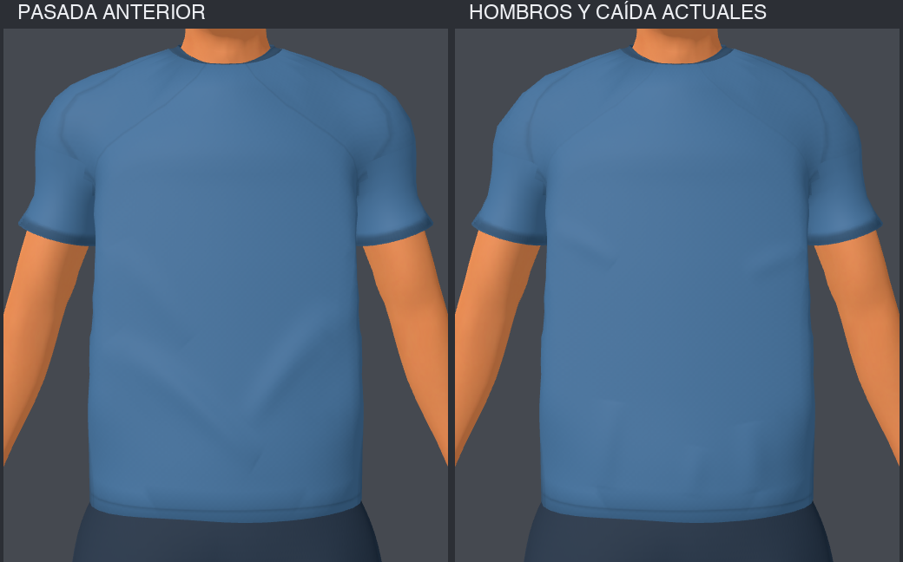

# Segunda pasada: hombros, axilas, mangas y caída

4 de octubre de 2026. Se continúa sobre la camiseta de la primera pasada,
manteniendo paleta, escala, cara, pelo, short, medias, botines y rig.

## Cambios aplicados

1. **Hombro:** reducción gradual del volumen del casquete: hasta 12 mm en altura,
   10 mm en el frente, 8 mm en espalda y 4 mm lateralmente, con máscaras suaves.
   Se atenúa la costura tonal para evitar que sugiera una hombrera separada.
2. **Axila y manga:** pequeña caída bajo axila y transición gradual hacia una
   sección oval uniforme, radios de 57/60 mm, conservando el largo de 15,8 cm.
   El borde mantiene el tejido y los pesos existentes; no se agrega una vuelta
   interior. La silueta sigue la inclinación del brazo en la pose de revisión.
3. **Pliegues:** se retiran las diagonales largas que se encontraban en el centro
   formando una V. Se usan cinco trazos cortos e independientes: dos de tensión
   lateral y tres casi verticales cerca del bajo, de 2,4 a 4,2 mm. Geometría y
   mapa normal comparten la misma definición `FOLDS`; el centro del torso queda
   despejado. Se reduce también la ondulación periódica de la espalda.
4. **Separación con piel:** la primera reducción de hombro dejó puntos de piel
   visibles en la clavícula. Se corrigieron ajustando únicamente la camiseta a
   la superficie de piel superviviente con un margen local de 3 mm. No se borró
   ni modificó la piel.

## Revisión visual

Capturas del GLB importado en Godot Compatibility con la misma iluminación de
estudio: [frente](front.png), [torso](torso.png), [perfil](torso_profile.png),
[espalda](back.png), [patada](patada.png), [celebración](celebracion.png).
No se observan los puntos de piel de la iteración intermedia en estas capturas.

Contexto real: [jugador en estadio](estadio.png) y
[cámara de juego](gameplay.png). La vista `gameplay` del script de preview usa
el encuadre de ataque del juego y FOV 55; sólo oculta la interfaz para inspección.
A esa distancia, la silueta y el dorsal son más relevantes que las costuras finas.

## Verificación técnica

PASS: `athlete_v3_test.gd`, `custom_players_test.gd`,
`kick_contact_and_dive_test.gd`; importación y renders nativos sin errores nuevos;
sintaxis Python y `git diff --check`. Exportación web release completada.

[Auditoría](auditoria-conservacion.json), comparada con la primera pasada:
pesos y UV del dorsal iguales, partes protegidas iguales, paleta y altura iguales,
53 huesos con matrices idénticas, ocho clips con curvas idénticas, mallas válidas
sin reparaciones. El GLB del arquero conserva su hash anterior.

El jugador mantiene 89.843 triángulos, 10 imágenes embebidas y atlas de camiseta
512². No se agregan materiales ni simulación de tela. No se midió FPS en esta
pasada. Las capturas y pruebas cubren las poses existentes inspeccionadas; no
prueban ausencia de interpenetración en toda pose futura.

Fuente editable y GLB actualizados. El generador incluye la segunda pasada al
reconstruir la base. Guardado localmente, sin nuevo commit ni publicación.

## Publicación posterior

Publicado a petición del usuario el 4 de octubre de 2026 en
[la URL del juego](https://futbol-tiros-libres-3d.netlify.app/).
Deploy `6ac2d8108f9d43b21a1bf318`. Se verificaron carga pública del menú y
coincidencia SHA-256 del paquete servido con el build local.
