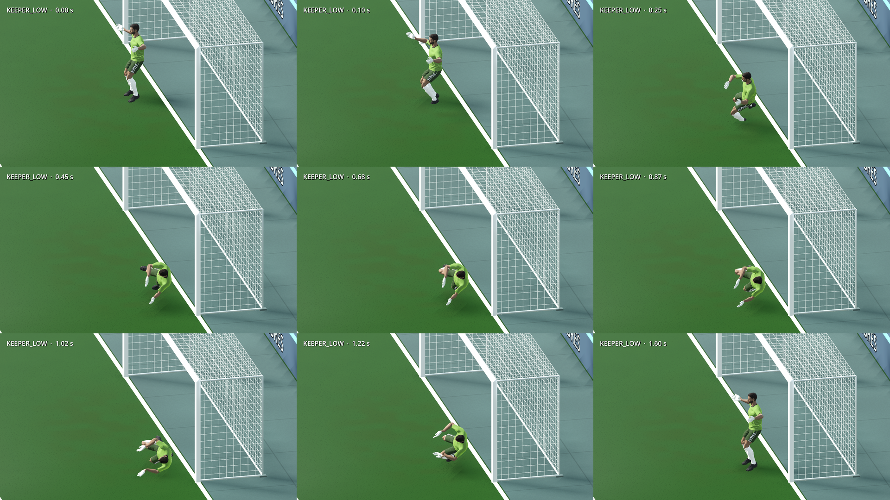
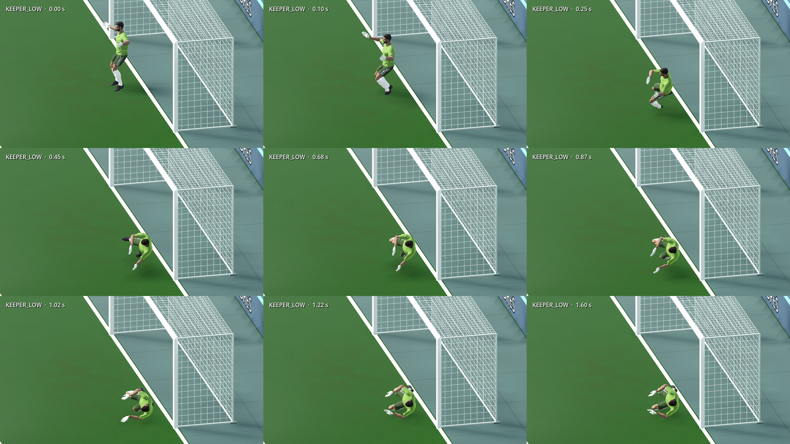
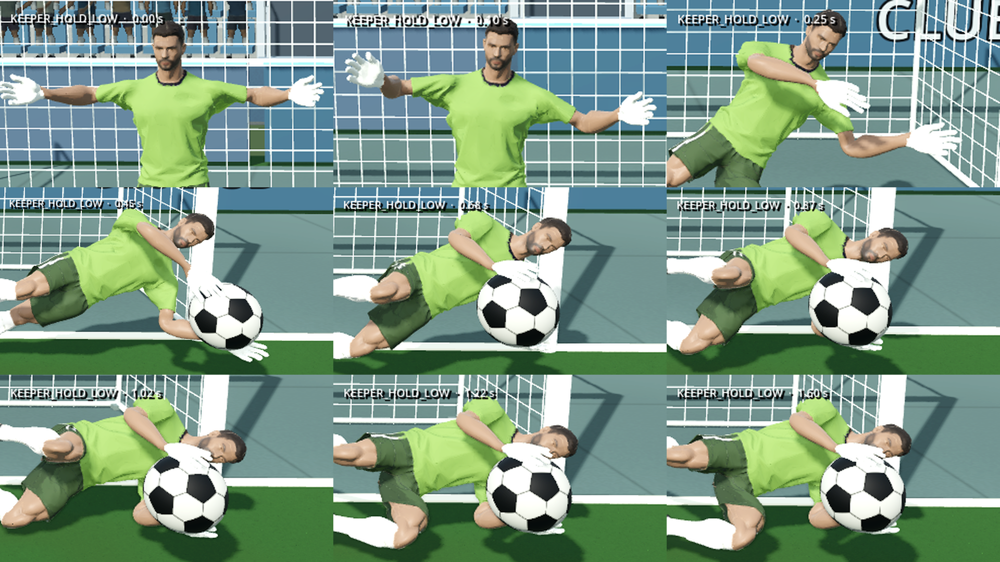
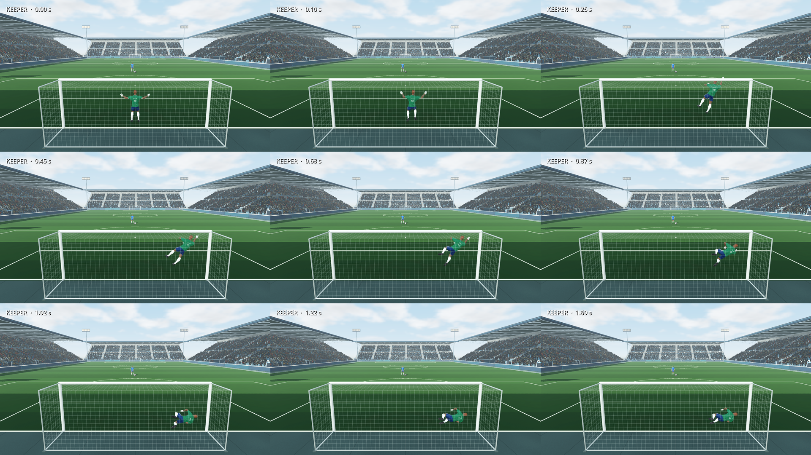
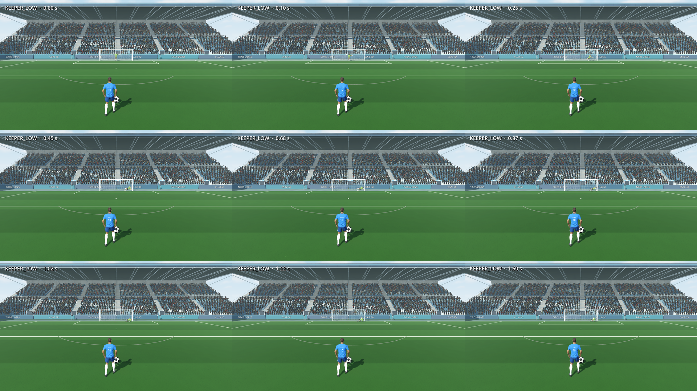

# Final de la atajada aplicado

La atajada lateral termina baja y de costado, con piernas recogidas y guantes
recogidos delante del torso. La captura mantiene la pelota entre las palmas
mientras el cuerpo completa la caída. La guardia abierta inicial vuelve al
reiniciar la siguiente jugada.

La [investigación de técnica real](../keeper-recovery-2026-10-13.md) reúne fuentes
primarias de FIFA Training Centre y The FA. Estas respaldan asegurar el balón
antes de levantarse y distinguir captura de rechazo. Los tiempos y ángulos
usados aquí son decisiones artísticas para este rig, no mediciones profesionales.

## Implementación

- `keeper.gd` conserva la intercepción y sustituye la subida a Ready por un
  asentamiento lateral. El arquero conserva ese estado hasta `reset_pose`.
- Los clips dejan de interpolar todo el rig hacia Ready al final. Las paradas
  centrales conservan su pose de recogida, sin forzar una caída lateral.
- Cuatro variantes `Hold*` cambian los brazos a captura sin cortar los tweens de
  caída. El cambio conserva la fase de la animación que estaba ejecutándose.
- En retención, los codos quedan bajo las muñecas y las palmas miran hacia la
  pelota. La posición del balón sigue los centros de las palmas, situados a
  0.12 unidades del eje de dedos del hueso Hand, con su transformación real.
- El apoyo final se corrigió tras detectar que una suela penetraba hasta
  3.6 cm: la prueba conserva el umbral de −3 cm y ahora también cubre el final
  completo hasta 1.6 s.

La guardia de la foto del usuario, las trayectorias de alcance y la corrección
del hueco bajo se conservan. No se agrandaron colisiones ni se cambió la IA.

## Verificación

La nueva regresión falló antes por volver a ponerse de pie o congelar una
captura en el aire. Ahora pasan 24 casos: ambos arqueros, ambos lados, tres
alturas y captura/rechazo. También verifica pelota sobre suelo, palmas hacia
balón, cercanía a ambos guantes y reinicio a la guardia original.

Pasan las pruebas de guantes, separación de brazos, suelo de las botas,
continuidad del vuelo, pausa, ciclo de animaciones, 13 sectores/alturas,
resultados físicos y los seis pateos completos de la regresión del hueco bajo.
Se adaptaron solamente las expectativas antiguas que exigían terminar en Ready;
los controles de muñecas, suelo, alcance y simetría mantienen sus límites.

Se revisaron capturas desde la cámara real de pateo y la del arquero, más una
vista lateral y una vista frontal cercana. El recorte de manos amplía píxeles
renderizados sin modificar pose o ángulo de cámara. La revisión adicional del
agente de investigación detectó y permitió corregir una captura que parecía
colgar entre las muñecas.

Los dedos del modelo siguen rígidos y abiertos: no tienen pesos de skinning
independientes. La retención se comunica mediante brazos, muñecas y palmas.

El build Web release local se regeneró y su PCK exportado también pasa los 24
casos de final/retención. No se publicó esta versión en Netlify en esta tarea.

## Capturas

