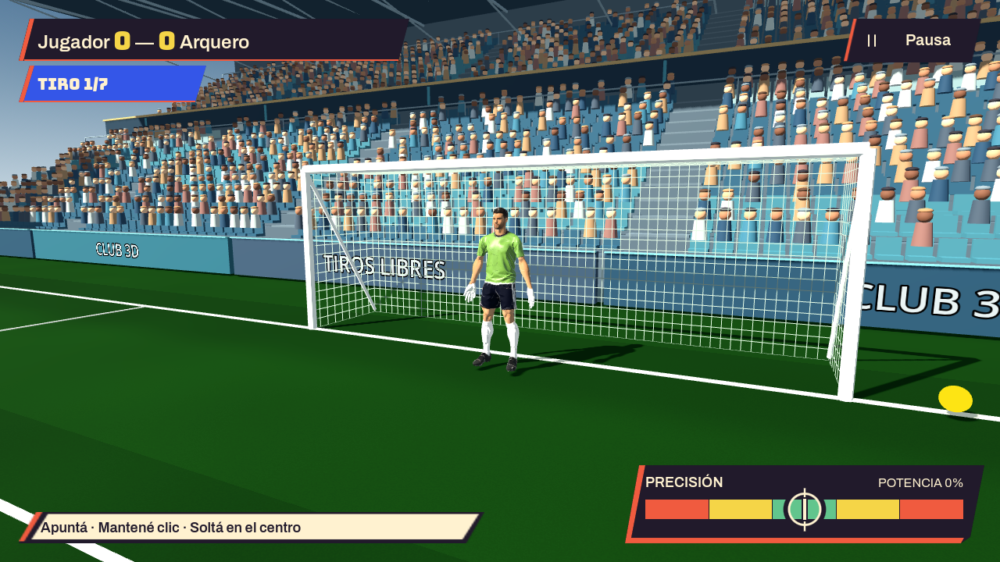
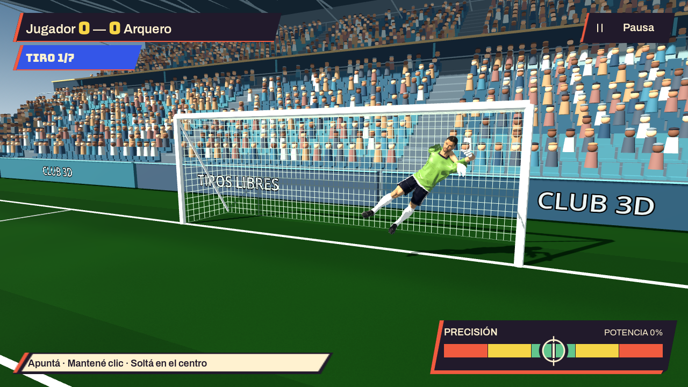

# Arquero con la misma base que PLAYER — 9 de octubre de 2026

Ambos arqueros usan `meshy_keeper.glb`, una variante del personaje completo
PLAYER. No hay otra generación ni consumo de créditos. Rostro, pelo, cuerpo,
short, medias y botines salen de la misma geometría y atlas del delantero.
La camiseta tiene una región recoloreable; las manos usan material de guante
y un engrosamiento gradual de hasta 3.5 mm. Se mantienen los pesos existentes.

La variante usa las ocho animaciones exactas del anterior `goalkeeper_v4.glb`,
incluyendo su Idle. No adopta las rotaciones de tiro libre de PLAYER.
Los 53 huesos y matrices de bind permanecen idénticos. El tamaño de runtime,
posición, lógica de atajada, colisiones y cálculo de pelota entre manos no cambian.

Color de camiseta, nombre y número siguen funcionando para el arquero local.
El arquero rival mantiene la camiseta verde oliva. La apariencia facial y el
pelo son los del modelo Meshy; los controles de piel, pelo y barba de la base
antigua no recolorean este atlas. Las piernas del short conservan el azul
marino de PLAYER. Esta variante tiene manga corta, igual que el modelo base.

Fuente editable: `source-assets/footballer/meshy_keeper.blend`.
Reconstrucción: `blender -b --python apps/free-kick-3d/tools/build_meshy_keeper.py`.
Auditoría: `python3 apps/free-kick-3d/tools/audit_meshy_keeper.py`.
El informe `integration.json` registra hashes y validación del GLB.

Validación completada:

- Auditoría GLB: rig y las ocho animaciones exactas respecto del arquero v4,
  101,904 triángulos, pesos normalizados y UV0/UV2 presentes.
- `meshy_keeper_test.gd`: ambos arqueros usan la base, actualización de nombre,
  dorsal/color sin recrear avatar y posición de pelota entre manos.
- `keeper_hands_test.gd`: captura y celebración; verificado también con OpenGL.
- `kick_contact_and_dive_test.gd`: contacto de patada y ambas estiradas.
- `custom_players_test.gd`: persistencia, guantes, camiseta y dorsal.
- `meshy_player_test.gd`: delantero PLAYER, dorsal, contacto y cambio de turnos.
- Inspección de `frente.png` y `estirada.png`, capturas del render nativo.

El renderer dummy de Godot emitió dos mensajes de material null al cerrar el
test aislado de manos; el mismo test con el renderer real OpenGL pasa sin esos
mensajes. Las demás pruebas y capturas no presentan errores.

Cambio local, sin commit ni publicación web. Licencia derivada CC BY 4.0,
atribución Meshy AI conservada en ASSET-LICENSES y en los créditos del juego.

