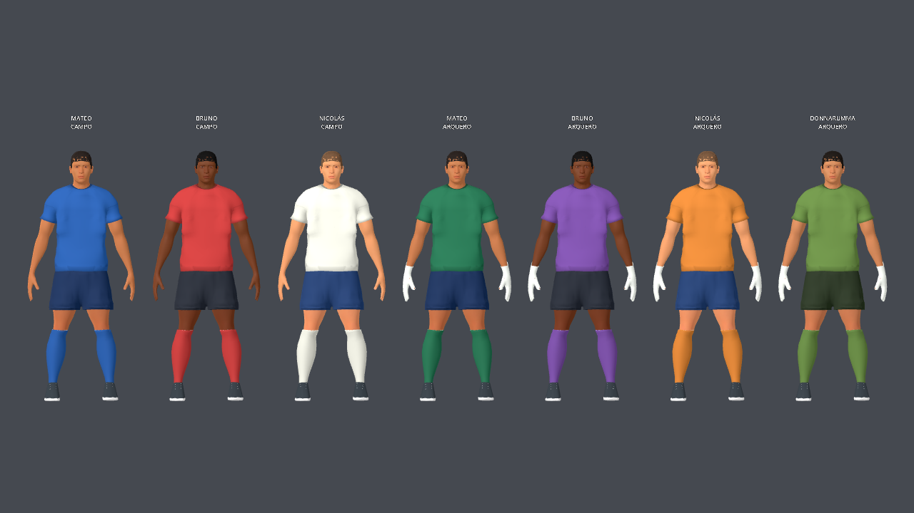
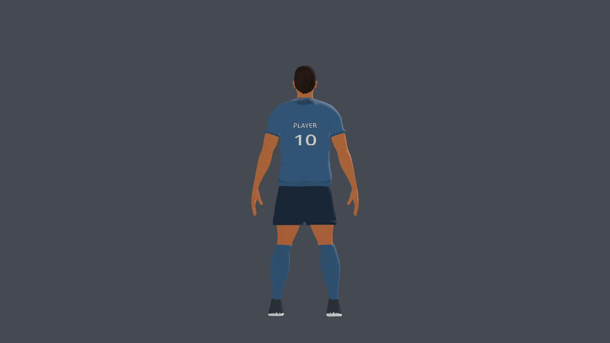
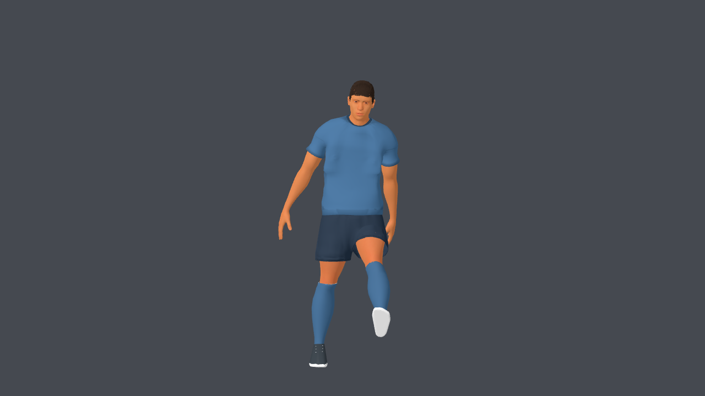
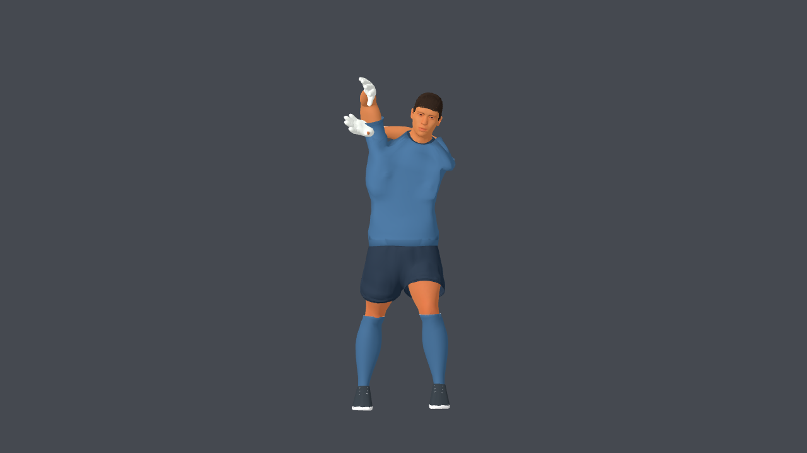
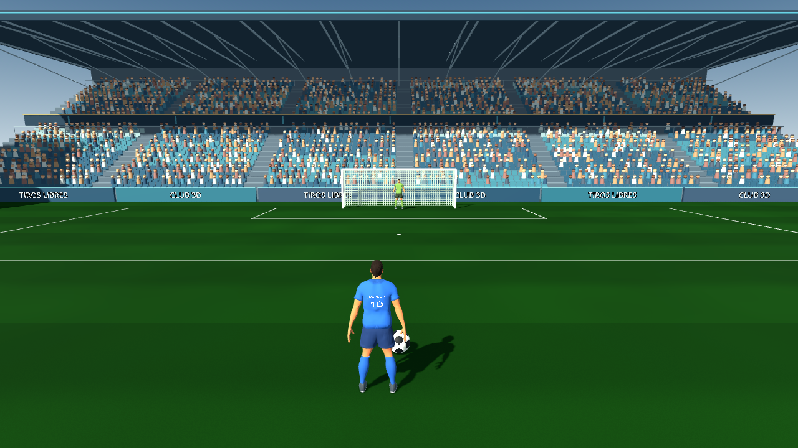

# Integración de ropa Meshy en el juego

6 de octubre de 2026. Pedido: «aplicalo en el juego».

La partida y los selectores usan `footballer_v4.glb` y `goalkeeper_v4.glb`.
Los tres delanteros, los tres arqueros ficticios, Donnarumma y los personajes
personalizados heredan esas dos bases. La versión v3 permanece como respaldo.

## Alcance y adaptación

Se incorporaron forma y texturas de camiseta y short del candidato Meshy 6 Lite.
Se conservó la anatomía atlética v3: rostro, pelo, barba, brazos, piernas, medias,
botines y guantes. No se sustituyó el cuerpo por la figura estática sin rig.

La separación directa del atlas único produjo bordes irregulares en cuello,
mangas y ruedos. Se descartó ese resultado y se proyectaron las superficies
generadas sobre la topología limpia de las prendas v3. La proyección está
limitada y suavizada para reducir pliegues excesivos; los contornos de cuello,
cintura y ruedos quedan fijados. Hombros y mangas mantienen la geometría probada
v3: moverla según la malla automática causaba roces con la piel durante las
estiradas. La transición al torso proyectado se desvanece suavemente.
El short conserva entrepierna baja, cintura
continua y largo a medio muslo; no hereda el arco alto del candidato crudo.

Los atlas se hornean por posición de superficie a 1024² sobre las UV originales.
Esto evita interpolar entre islas inconexas del atlas de Meshy. Se neutraliza
el color para mantener la paleta y se deriva un relieve de tela suave en la base
tangente de esas UV. Cuello y mangas tienen vivos tonales finos. Las UV2 del
dorsal y los pesos originales se mantienen exactamente; nombres y números
siguen siendo dinámicos, sin logos horneados.

El horneado respeta el wrap de U: incluye las caras que cruzan el límite 0/1.
Omitirlas dejaba una franja sin hornear visible en el centro de la espalda.

## Preservación y reproducción

`integration-footballer.json` e `integration-goalkeeper.json` registran hashes
antes y después de geometría, pesos y UV de las partes protegidas, pesos/UV de
las prendas, matrices de los 53 huesos y curvas de los ocho clips.
El generador falla si alguno cambia. `audit_meshy_export.py` compara además las
matrices inverse-bind y todos los canales de animación del GLB final contra v3,
comprueba coordenadas finitas y pesos normalizados, y escribe el manifiesto v4.

```sh
blender -b --python apps/free-kick-3d/tools/integrate_meshy_kit.py -- footballer
blender -b --python apps/free-kick-3d/tools/integrate_meshy_kit.py -- goalkeeper
# Revisar candidatos bajo source-assets/footballer/meshy-trial-2026-10-06/integration/
# Copiar los dos GLB aprobados a apps/free-kick-3d/assets/footballer/
python3 apps/free-kick-3d/tools/audit_meshy_export.py
```

## Validación en Godot 4.7.1

Pasaron las comprobaciones de `athlete_v3_test`, `custom_players_test`,
`keeper_hands_test`, `kick_contact_and_dive_test`, `keeper_save_balance_test`
y `menu_flow_test`. La prueba anatómica se repitió después de importar las
exportaciones finales. El contacto de manos también pasó con Compatibility,
además del test headless. Los 13 casos de atajadas comprueban lados/alturas
correctos e incorrectos; ninguna lógica ni collider del juego se modificó.

Se capturaron Idle frontal/espalda/perfil, Kick, Celebrate, Catch y las cuatro
estiradas con el renderer real. La evaluación comparada con v3 permitió
corregir roces de las mangas y el wrap del atlas antes de conservar v4.
Las pruebas headless mostraron mensajes del renderer Dummy durante algunos
cierres y el test de 13 partidas conserva su aviso de recursos al salir; las
capturas y la prueba de manos en Compatibility terminaron sin esos errores.

La exportación mantiene **89.843 triángulos** para campo y **96.571** para
arquero: el mismo presupuesto geométrico de v3. No se añadió la malla estática
Meshy de 101.904 triángulos encima del personaje.

Medición nativa en Apple M4 a 1280×720: **119,1 FPS** en bajo, **90,6** en
medio y **88,3** en alto, con 300 frames medidos por calidad después de 90
de calentamiento. P95: 9,29 / 12,22 / 12,52 ms. No es una medición en navegador.
Datos y hashes de los modelos medidos: `rendimiento-v4.json`.











## Licencia y publicación

La adaptación del uniforme usa **CC BY 4.0**, atribuida a **Meshy AI
(Meshy 6 Lite)**, con modificaciones indicadas. La atribución visible está en
**Configurar → Créditos**; procedencia detallada en `ASSET-LICENSES.md` y en el
manifest de la prueba. Cuerpo y assets anatómicos conservan sus licencias CC0.
La generación costó 20 créditos gratuitos y cero dinero.

Esta entrega cambia el juego local. No ejecuta una publicación en Netlify.
