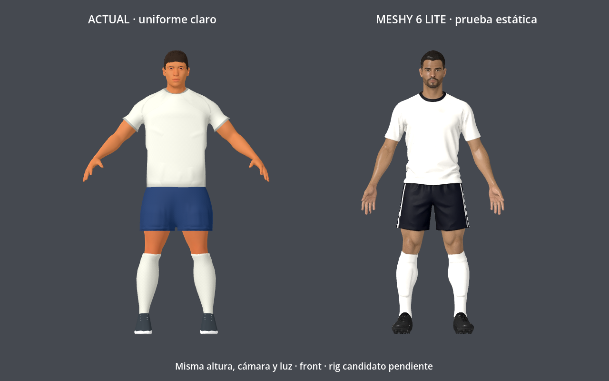
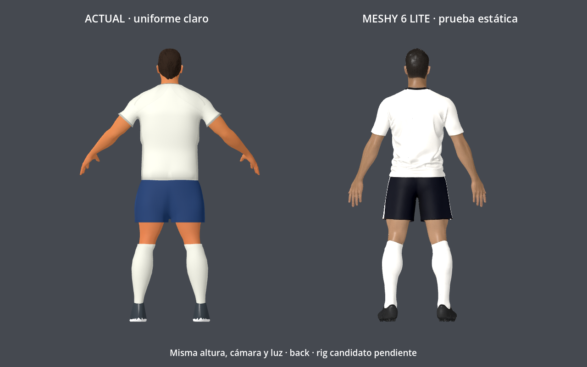
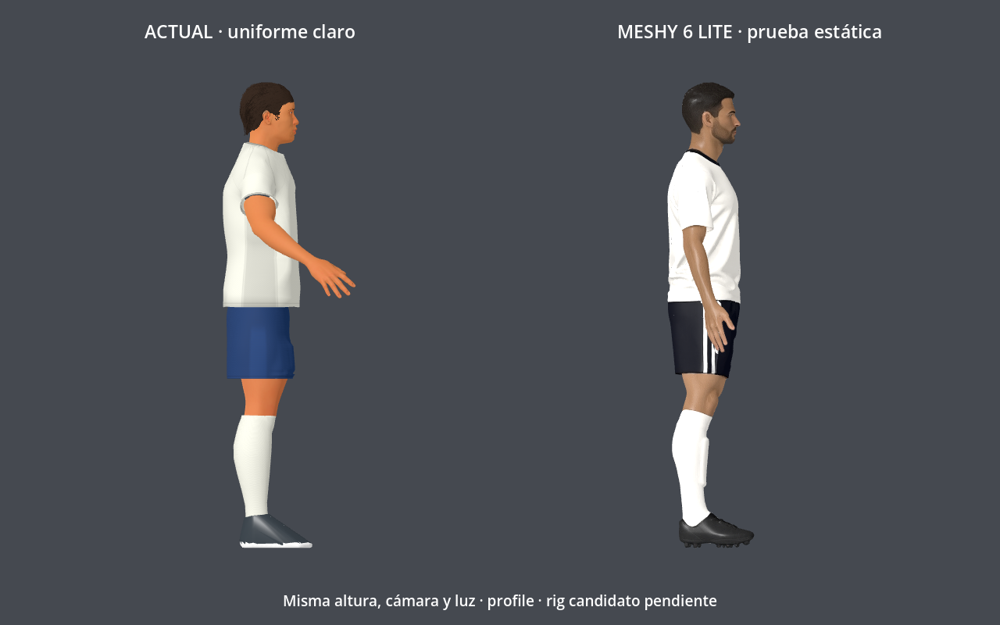

# Resultado de la prueba Meshy gratuita

Fecha: **6 de octubre de 2026**. Se ejecutó una prueba real, con tres agentes investigando límites del servicio, referencia visual e integración del rig. El resultado permanece aislado del juego publicado.

**Seguimiento:** por pedido del usuario se adaptó la ropa al juego local como v4.
Este documento conserva la evaluación del GLB crudo; la implementación y sus
validaciones están en [integracion-aplicada.md](integracion-aplicada.md).

## Decisión

**Vale la pena limpiar y probar esta base, pero todavía no reemplazar el personaje actual.** La camiseta mejora la continuidad del hombro, la forma de las mangas y la caída del tejido. El pecho está contenido. El short vuelve a tener una entrepierna alta: debe bajarse y simplificarse antes de trabajar en los pesos. La lectura de las piernas es más anatómica, sin demostrar que sean más fuertes que las actuales.

La malla generada tiene rostro, pelo y botines diferentes porque es una alternativa independiente. Esas partes no se trasladaron a producción. La adaptación prevista conserva las partes originales protegidas y el esqueleto actual.

## Lo que se hizo

1. Analizar la captura entregada: se eligió al jugador de camiseta clara como referencia de silueta y ropa. La captura completa, con interfaz, dos jugadores y brazos cruzados, no se envió a Meshy.
2. Crear una referencia propia en pose A mediante la herramienta integrada `imagegen`. Entrada visual: captura del usuario como referencia de estilo; salida: un solo futbolista frontal, fondo neutro, camiseta clara, short oscuro, medias claras y botines oscuros, sin textos ni marcas. El prompt exacto está en la carpeta de fuentes.
3. Usar la sesión existente de Meshy, seleccionar **Image to 3D → Meshy 6 Lite → CC BY 4.0** y dejar Pose desactivado. La interfaz indicó **10 créditos** para geometría y **10 créditos** para texturizado PBR desde la misma imagen. Se ejecutó una generación y un texturizado, sin compras ni suscripción.
4. Descargar el GLB texturizado. La carga automática necesitaba un permiso de extensión, por lo que se usó el selector nativo de Chrome. La descarga interceptada falló; se recuperó el archivo desde el enlace de descarga emitido por Meshy. No se cambiaron permisos de Chrome.
5. Cargar ambos GLB en un proyecto Godot independiente, renderizar frente, espalda y perfil, y auditar el candidato real. El personaje actual usa una copia de sus shaders/materiales de personalización; el candidato conserva sus mapas Meshy.

La cuenta mostraba 120 créditos antes de generar. Durante la prueba Meshy acreditó automáticamente un bono diario de 30 créditos; terminó en 130: **120 + 30 − 10 − 10**. El gasto fue de 20 créditos gratuitos y cero dinero. El indicador 17 correspondía a notificaciones en la captura, no se usó como cuota de descargas. El diálogo de descarga mostró `x10` antes de descargar.

## Comparación reproducible

La altura visible se normalizó a **1.898873 m**, con pies al suelo, misma cámara ortográfica y misma luz. Esta cifra es la altura actual del proyecto, no una medida oficial de Football Strike. Las poses A tienen inclinaciones de brazo diferentes y las texturas no son idénticas: las capturas comparan forma y apariencia estática, no equivalencia de skinning. Todavía falta la comparación en la cámara del partido y la medición en navegador.

## Auditoría del GLB descargado

| Propiedad | Candidato |
|---|---:|
| Triángulos | 101,904 (+13.42% frente al jugador actual) |
| Vértices exportados | 59,055 |
| Posiciones geométricas únicas | 50,944 |
| Archivo | 7,765,716 bytes |
| Altura original | 1.899616 m |
| Materiales | 1 |
| Mapas | 3 JPEG de 2048 × 2048 |
| Componentes conectados al soldar posiciones | 1 |
| Bordes abiertos / aristas no manifold / caras colapsadas | 0 / 0 / 0 |
| Rig, pesos, clips y UV2 | Ausentes |

La malla cerrada facilita la evaluación, pero no demuestra deformación correcta. Hay 73 caras cuyo promedio de normales no coincide con el winding; requieren revisión localizada. El atlas único mezcla piel, ropa y pelo, por lo que no permite aplicar directamente los colores y dorsales personalizables del juego. La auditoría completa está en `candidato-auditoria.json`.

## Orden recomendado para continuar

1. **Short:** bajar el centro de la entrepierna, mantener cintura continua y enderezar la caída hasta medio muslo. Inspeccionar frente, espalda y perfil sin cambiar el largo exterior por accidente.
2. **Camiseta:** suavizar pliegues concentrados en cintura, adelgazar los dobladillos y ajustar el blanco al tono del proyecto. Conservar la mejora del hombro y el pecho moderado.
3. **Geometría y materiales:** segmentar prendas/piel, reducir o reconstruir topología donde deba doblar y preparar materiales independientes. Reconstruir UV2 para nombres y dorsales dinámicos; el número no se horneó en esta prueba.
4. **Rig:** trabajar en una copia, conservar los 53 huesos y ocho clips originales, alinear articulaciones y transferir pesos por regiones. No aplicar el modificador Armature ni modificar la rest pose original para adaptar el candidato.
5. **Validación:** probar patada, celebración, captura y cuatro atajadas, personalización, clipping y rendimiento web. Extender al arquero y demás jugadores solamente tras aprobar la base.

No se ejecutó transferencia de pesos ni se probaron animaciones del candidato, porque el archivo descargado carece de rig. Los tres renders de estudio terminaron correctamente en Godot 4.7.1 Compatibility. No se cambió ningún GLB, fuente `.blend` ni script del juego para esta prueba.

## Archivos e investigación

- Fuente de prueba: `source-assets/footballer/meshy-trial-2026-10-06/`, con referencia, prompt, GLB original, manifest y proyecto de comparación.
- `meshy-gratis.md`: límites, costes y contradicciones de documentación contrastadas con interfaz.
- `referencia-visual.md`: dirección de arte y crítica de las capturas reales.
- `integracion-rig.md`: contrato actual y ruta de adaptación.
- `meshy-resultado.jpg`: evidencia del modelo generado en la cuenta.

El modelo experimental fue generado por **Meshy AI** y se conserva bajo **CC BY 4.0**, con procedencia registrada. Si se incorpora al juego, se añadirá la atribución correspondiente a los créditos y licencias de producción. La prueba no se publicó en Community. [Plan Free](https://help.meshy.ai/en/articles/15696428-what-is-included-on-the-free-plan), [términos de Meshy](https://www.meshy.ai/terms-of-use).
