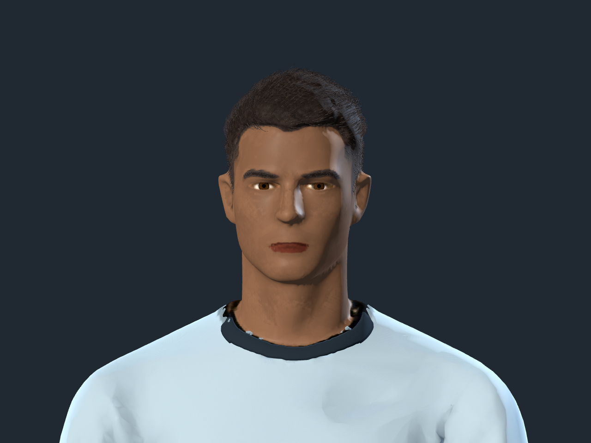
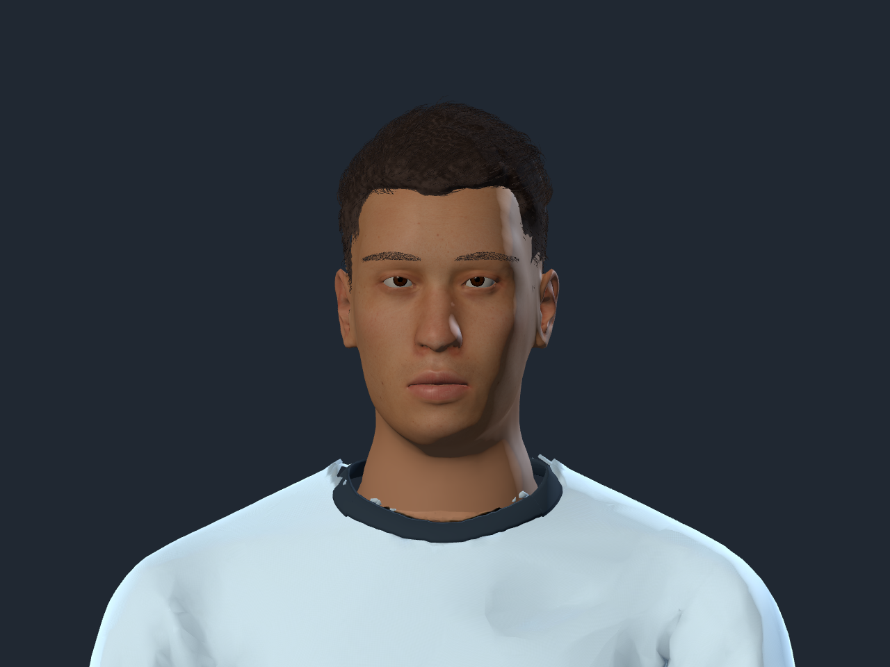

# Cabeza anatómica — 14 de octubre de 2026

La corrección posterior de pelo y barba está documentada en
[player-groom-fix-2026-10-14](../player-groom-fix-2026-10-14/README.md).
La segunda revisión de barba, mirada y proporciones está en
[player-face-polish-2026-10-14](../player-face-polish-2026-10-14/README.md).
Las capturas y cifras de esta página corresponden a la reconstrucción inicial;
`striker.json` y `keeper.json` se actualizan al exportar los assets vigentes.

La cabeza de delantero y arquero se reconstruyó a partir de la anatomía CC0
MPFB/MakeHuman que ya estaba en el proyecto. La nueva superficie reemplaza la
cara anterior, con párpados, labios, nariz, orejas y una unión de cuello ajustada.
Los dos globos oculares tienen volumen propio: el iris y la pupila se dibujan
en su material, con reflejo corneal; la piel ya no lleva ojos pintados.

## Comparación real dentro de Godot

Mismo encuadre, personaje, pose y luces; capturas del motor, sin retoque.

Antes:



Después:



[Con barba](studio/face.png) · [Perfil](studio/profile.png) ·
[Cuerpo completo](studio/shirt.png) · [Remate](studio/kick.png) ·
[Arquero en el editor](editor/keeper-clean.png) · [Atajada](keeper-save.png)

## Materiales y personalización

- Atlas facial exclusivo, UV con mayor densidad en la cara, albedo generado de
  **1254 × 1254 nativos**. La guía de horneado es 2048²; no se presenta esa
  resolución de guía como detalle real de la textura final.
- Color de piel calibrado contra el pigmento del atlas; labios, párpados y
  microdetalle conservan variación al usar cualquiera de los nueve tonos.
- Roughness diferenciada para piel, nariz y labios, con relieve fino discreto.
- Cejas reconstruidas con fibras sobre la nueva superficie; barba anterior
  adaptada y cobertura ajustada al rostro. Ambas siguen el color de cabello.
- `FaceSkin`, `FaceInterior` y `EyeSurface` independientes del atlas corporal.
  Las UV del nombre/dorsal quedan fuera del rango imprimible en toda la cabeza.

## Validación

`striker.json` y `keeper.json` contienen la auditoría de los GLB finales:

- 53 huesos y ocho clips idénticos a los baselines persistentes.
- Geometría, UV y pesos de camiseta, short, cuello de tela, guantes, pelo y
  cuerpo por debajo del cuello conservados frente a los GLB previos al cambio.
- Coordenadas, normales, UV, articulaciones y pesos válidos; ojos con volumen
  suficiente detrás de los párpados, unidos al hueso Head.
- 274 813 triángulos en delantero y 274 817 en arquero antes de LOD.
  La superficie facial tiene 29 886 y los ojos 2 752 triángulos.

Se aprobaron `custom_players`, `meshy_player`, `meshy_keeper`,
`striker_animation`, `keeper_animation` y `character_editor`. Los cinco primeros
se ejecutaron headless; el editor y las capturas, con el renderer nativo.
El entorno headless emite un aviso de acceso al almacén de certificados de
macOS; no produjo errores de GDScript ni fallos de las pruebas.
Resultados: [tests.json](tests.json).

La comprobación sobre capturas reales verifica nueve tonos distinguibles,
piel media sin recorte de luces, labios que acompañan el tono y barba que no
modifica las cejas: [appearance-checks.txt](appearance-checks.txt).

## Costo y alcance

Godot 4.7.1 Compatibility / OpenGL, Apple M4, 1280 × 720, nueve avatares:
24,57 ms promedio y 26,22 ms p95, con 90 llamadas de dibujo y 184 284 primitivas
renderizadas tras LOD. Es una escena de estrés nativa, sin medir Web o móvil.
Datos completos: [performance.json](performance.json).

La cabeza mejora la anatomía y el material. La expresión facial sigue siendo
estática: esta entrega no agrega parpadeo ni animación de boca. Las identidades
comparten anatomía, como antes. El peinado y las prendas conservan su diseño
anterior, incluidas sus limitaciones de acabado en los bordes del cuello.

## Fuentes y reconstrucción

Fuentes finales: `source-assets/footballer/meshy_striker_head.blend` y
`meshy_keeper_head.blend`. La etapa anterior `_realism.blend` se conserva
como entrada reproducible; no se acumulan modificaciones al reconstruir.

```sh
blender -b --factory-startup --python apps/free-kick-3d/tools/rebuild_player_head.py -- striker keeper
godot --headless --editor --path apps/free-kick-3d --quit
python3 apps/free-kick-3d/tools/audit_player_head.py
```

La comparación exacta de partes protegidas acepta además una carpeta con los
GLB anteriores: `audit_player_head.py /ruta/a/baseline`.
`rebuild_player_head.py -- prepare` regenera la guía UV, sin invocar servicios
de imágenes ni reemplazar la textura aprobada.

La textura fue creada mediante la herramienta integrada OpenAI image_gen.
Prompt y procedencia:
[face.prompt.txt](../../../source-assets/footballer/head-2026-10-14/face.prompt.txt),
[manifest.json](../../../source-assets/footballer/head-2026-10-14/manifest.json).
