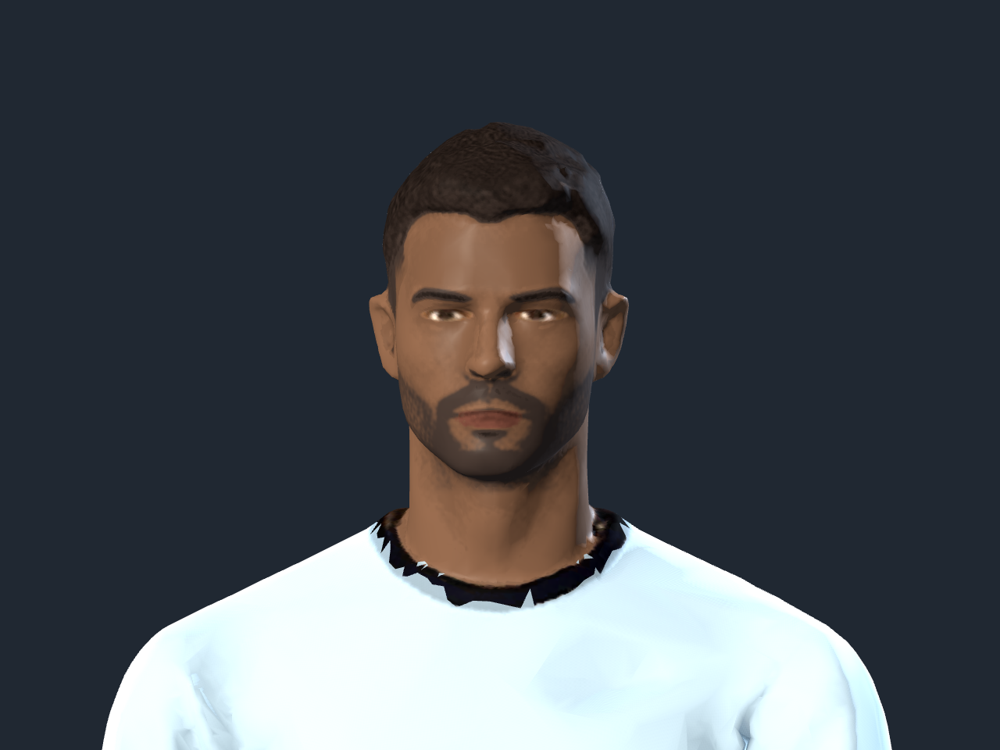
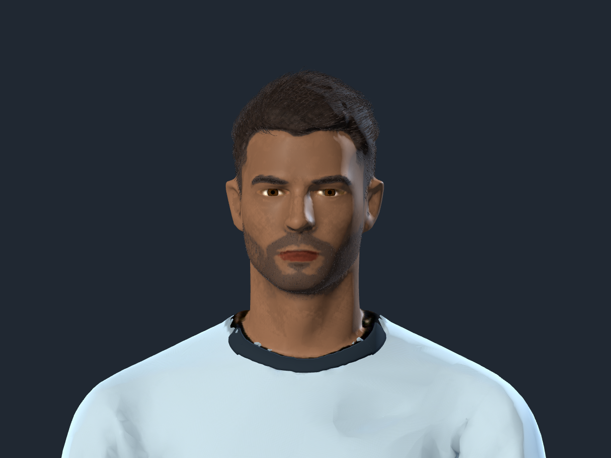
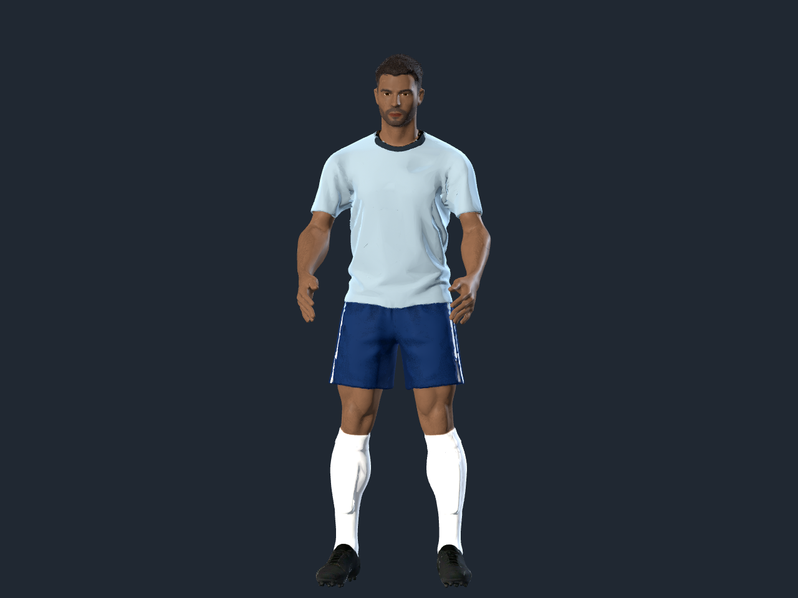
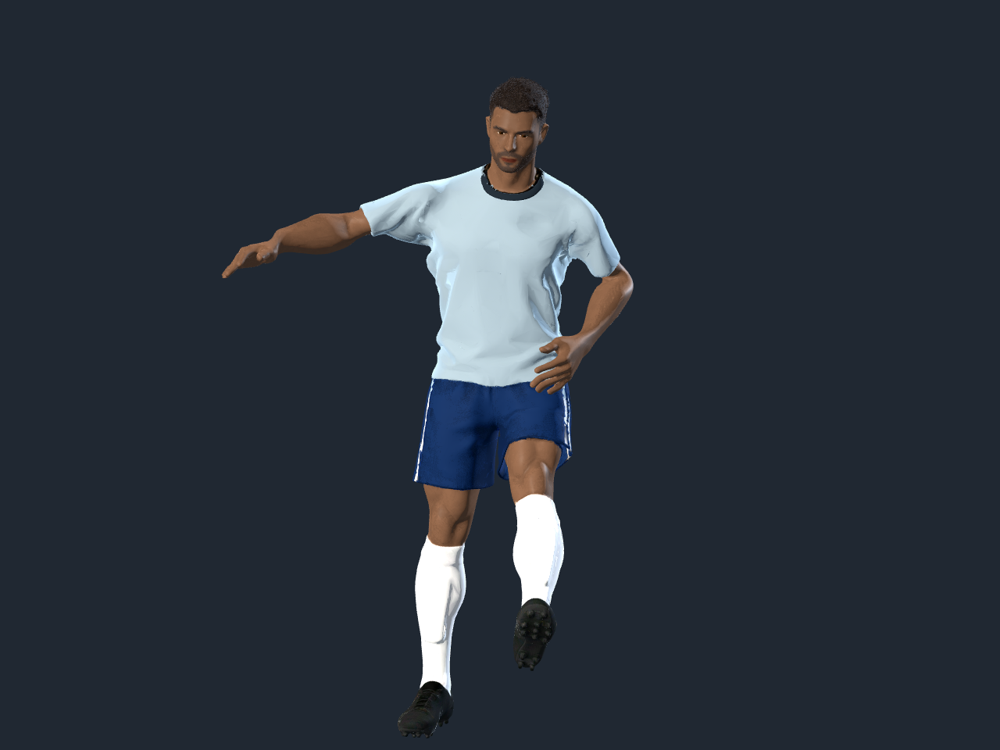

# Jugador: geometría, pelo, piel y ropa

Dirección elegida a partir de las tres referencias aportadas por el usuario:
futbolista adulto con anatomía suave, pelo corto con fibras visibles, barba
recortada, piel con poros discretos y poliéster deportivo con volumen. Se adapta
el personaje existente; las imágenes de EA se usan como referencia de acabado,
sin incorporar sus texturas, marcas o jugadores al juego.

Godot 4.7.1, Compatibility/OpenGL, Blender 5.2.2. Objetivo: editor a 1280×720,
inspección a 1280×960 y cámara de juego existente. Altura/escala del jugador y
ejes conservados. Mipmaps y LOD automáticos del importador siguen activos.

- Subdivisión localizada y suavizado de cabeza/silueta. Se actualizan las
  normales conservando la orientación original de las caras abiertas.
- 3.400 fibras de pelo, 2.300 de barba y 340 de cejas, con raíces y puntas
  afinadas. Materiales separados y colores sincronizados con la personalización.
- Ojos con superficie propia, iris, pupila, gradación de esclerótica y brillo.
  Labios con pigmento dependiente de la piel y rugosidad diferenciada.
- Microtextura de piel generada con OpenAI image_gen; mezcla tenue y filtrada
  por mipmaps. No se reemplazan las islas UV ni los atlas de origen.
- Camiseta y short separados en sus límites, con holgura y retorno interior
  de 3,5 mm en los bordes. Cuello 3D ajustado al desplazamiento real del cuello
  del modelo. La ropa sigue los mismos pesos del esqueleto; no hay simulación
  dinámica de tela.

Las fuentes previas `meshy_*_cloth_v2.blend` se conservan. Las nuevas fuentes
editables son `source-assets/footballer/meshy_*_realism.blend`. Los GLB usados
por el juego mantienen sus rutas `assets/footballer/meshy_striker.glb` y
`meshy_keeper.glb`. Esta revisión reemplaza los contratos históricos que exigían
igualdad de geometría/UV por vértice o reducción de polígonos en las auditorías
de cloth-v2: la nueva auditoría exige integridad del rig, clips y skinning.

Desde la raíz del repositorio:

```sh
blender -b --python apps/free-kick-3d/tools/build_player_realism.py -- striker keeper
godot --headless --path apps/free-kick-3d --editor --import --quit
python3 apps/free-kick-3d/tools/audit_player_realism.py
godot --path apps/free-kick-3d --script res://tools/preview_player_realism.gd -- /tmp/player-realism
godot --path apps/free-kick-3d --script res://tools/preview_appearance.gd -- /tmp/player-appearance
```

La auditoría comprueba 53 huesos, los ocho clips y todos sus canales exactos,
pesos normalizados, UV0/UV2, superficies independientes y exclusión del dorsal
en ojos y pelo. Verifica además la orientación de 6.593 vértices de referencia:
ninguna normal invertida. `striker.json` y `keeper.json` registran conteos, tamaño y hash
del GLB final. Pruebas de integración: `custom_players`, `meshy_player`,
`meshy_keeper`, `character_editor`, `striker_animation` y `keeper_animation`.

Referencias técnicas consultadas: [BMesh](https://docs.blender.org/api/current/bmesh.ops.html),
[shaders de Godot 4.7](https://docs.godotengine.org/en/4.7/tutorials/shaders/shader_reference/spatial_shader.html).
Procedencia del detalle de piel y prompt completo:
`source-assets/footballer/realism-2026-10-14/skin.prompt.txt`.

## Resultado y validación

Delantero: **91.826 → 241.062 triángulos**. Arquero: **241.066 triángulos**.
El archivo GLB de cada rol ocupa aproximadamente 15,8 MB. El detalle extra
prioriza primeros planos; el importador genera LOD para reducirlo a distancia.

Pruebas de personalización, selección de jugador/arquero, editor y animaciones
aprobadas. El editor se comprobó también con OpenGL real, sin los avisos de
material nulo que produce el renderizador dummy en esa prueba. Las capturas
reales de los nueve tonos de piel pasan `check_appearance_renders.py`: tonos
distinguibles, labios que siguen la piel y barba que no oculta las cejas.

En la escena de estrés de nueve avatares, 1280×720, Apple M4/OpenGL, la medición
aislada dio 19,97 ms de media, 22,07 ms de percentil 95 y 72 llamadas de dibujo.
`performance.json` conserva la lectura completa. Es una medición local del
ejecutable de desarrollo; no garantiza rendimiento web o móvil. No se publica
una comparación de FPS con el punto inicial porque la captura inicial se
solapó con otra ventana y no ofrece condiciones equivalentes.

La base sigue siendo el personaje generado existente, con sus limitaciones
anatómicas y del atlas. No equivale a un escaneo facial de un juego AAA; la
mejora se centra en el detalle de superficie, la silueta y las prendas.

### Primer plano con la misma cámara y luces

Antes:



Después:



### Prendas y movimiento




Las demás vistas están en `studio/` (perfil, espalda y sin barba) y `editor/`
(nueve tonos, barba y arquero). La textura generada y su hash están en el
manifiesto de `source-assets/footballer/realism-2026-10-14/`.
