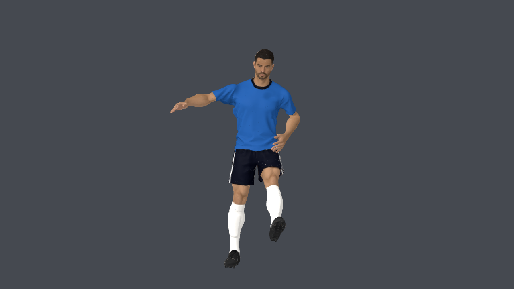

# Una sola base 3D para todos los delanteros

El selector anterior usaba PLAYER solo con índice 4; los índices 0, 1, 2 y 3,
el delantero por defecto y el rival seguían usando `footballer_v4.glb`.
Ahora `kicker.gd` instancia siempre `meshy_striker.glb`, una variante de PLAYER
que separa la camiseta para recolorear. Mantiene los colores de camiseta de
las identidades, nombre y dorsal, y reutiliza una sola instancia al cambiar
de turno o identidad. Esto incluye la vista previa del menú.

El cuerpo, cara, pelo, barba, short, medias y botines son los de PLAYER. Los
controles antiguos de color de piel/pelo/barba no alteran el atlas de esta base.
Las dos instancias de arquero siguen usando su variante PLAYER con guantes
y las animaciones de arquero. No se cambian esqueleto, temporización de patada,
movimientos de piernas, colisiones ni lógica de atajada.

Fuente editable: `source-assets/footballer/meshy_striker.blend`.
Herramientas: `build_meshy_striker.py`, `split_meshy_jersey.py` y
`audit_meshy_striker.py` en `apps/free-kick-3d/tools/`.

Auditoría del GLB: geometría, normales, UV0/UV2, pesos, matrices de bind y las
ocho animaciones exactamente iguales a `meshy_player.glb`, incluyendo los brazos
de tiro libre. Conserva 101,904 triángulos y 53 huesos. El informe
`integration.json` registra hashes. No hay generaciones ni créditos nuevos;
la licencia y atribución Meshy CC BY 4.0 se conservan.

Pruebas completadas:

- `meshy_player_test.gd`: las cinco opciones reutilizan la misma instancia,
  conservan colores/dorsal, contacto con pelota y base nueva en ataque y defensa.
- `custom_players_test.gd`: persistencia y camiseta/dorsal para ambos roles.
- `striker_arms_test.gd`: gesto de brazos, continuidad, rig y piernas conservadas.
- `athlete_v3_test.gd`: anatomía, mapas, UV de dorsal y materiales independientes;
  actualizado para comprobar el modelo activo actual.
- `kick_contact_and_dive_test.gd`: contacto y estiradas del arquero.
- Captura nativa e inspección de la opción 0 con camiseta azul.

Solo aplicado al juego local. Sin commit ni publicación web.

